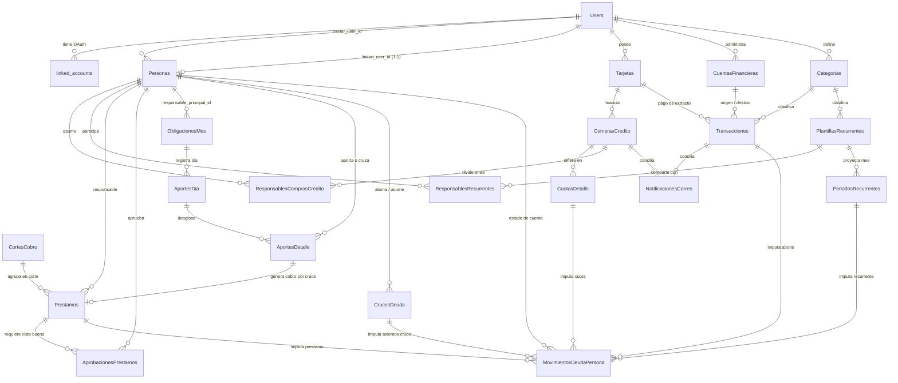

# Documentación de Arquitectura de Datos y Guía de Integración Backend (Supabase / PostgreSQL)

> **Propósito del Documento:** Especificación técnica completa de las **21 tablas** del motor financiero en **Supabase (PostgreSQL)**, detallando cambios estructurales frente a la versión anterior, diccionario de datos, relaciones (`FK`), triggers automáticos, vistas, scripts de *backfill*, índices y consultas optimizadas para la capa de persistencia del backend.

---

## 1. Resumen Ejecutivo de la Evolución Arquitectónica

La base de datos evolucionó de un registro aislado de tarjetas de crédito y una aplicación externa en AppSheet hacia un **ERP Financiero Personal y Familiar Multi-Tenant** centralizado en Supabase:

1. **Precisión Monetaria Estricta (`float4`/`float8` $\rightarrow$ `numeric`):**
   * Todas las columnas monetarias y tasas de interés en `ComprasCredito`, `CuotasDetalle`, `ResponsablesComprasCredito`, `Prestamos` y `Tarjetas` fueron migradas de tipos flotantes binarios a `numeric` (`BigDecimal` en Java).
   * **Impacto en Backend:** Los DTOs, entidades y repositorios deben mapear todos los montos y porcentajes a `BigDecimal` (nunca `Float` ni `Double`) para evitar errores de redondeo IEEE 754.
2. **Eliminación Definitiva de AppSheet (`DROP TABLE "Usuarios"`):**
   * La tabla legacy `"Usuarios"` fue eliminada. Toda identidad humana de negocio vive en `"Personas"` (conectada opcionalmente a `"Users"` vía `linked_user_id` cuando la persona tiene credenciales de acceso a la app).
   * Los módulos que antes vivían en hojas de cálculo (`Cortes`, `Aportes_Carro_Mes`, `Aportes_Carro_Dia`, `Aportes_Carro`, `Prestamo`, `Aprobaciones_Prestamos`) ahora son tablas relacionales nativas con integridad referencial.
3. **Soporte Multi-Tenant (`owner_user_id`):**
   * Se añadió `owner_user_id` (`FK -> Users.id`) en las tablas maestras y transaccionales para permitir que múltiples usuarios lleven su propia contabilidad aislada dentro de la misma base de datos.
4. **Soporte Multimoneda (`USD` / `COP`) y Ciclos de Facturación:**
   * `ComprasCredito` y `Transacciones` ahora soportan compras en moneda extranjera (`moneda_original`, `valor_moneda_original`/`monto_original`, `tasa_cambio_aplicada`/`tasa_cambio` y flag `trm_confirmada`).
   * `CuotasDetalle` incorpora `periodo_facturacion` (`CHAR(7)`, formato `'YYYY-MM'`) para indexar cobros mensuales sin cálculos costosos de fechas en cada consulta.
5. **Sub-Ledger Contable Unificado (`MovimientosDeudaPersona` y `CrucesDeuda`):**
   * Centraliza como cuenta corriente (`signo = +1` cargo a favor tuyo / `-1` abono de la persona) cualquier obligación de terceros originada en cuotas de tarjetas, préstamos directos, gastos recurrentes compartidos (mercado/servicios), aportes diarios o cruces triangulares de deuda.

---

## 2. Mapa de Dominios y Diagrama Entidad-Relación (Mermaid)



---

## 3. Diccionario Detallado de las 21 Tablas y Cambios para el Backend

### Dominio 1: Identidad, Autenticación y Contactos

#### 3.1 Tabla `Users`
Gestiona las credenciales y cuentas de usuario autenticadas en la aplicación.

| Columna | Tipo | Restricciones | Descripción Técnica |
|---|---|---|---|
| `id` | `int8` | `PK` | Identificador único del usuario autenticado. |
| `email` | `text` | `UNIQUE` | Correo electrónico de login. |
| `password_hash` | `varchar` | `Nullable` | Hash de contraseña (nulo si usa exclusivamente OAuth). |
| `role` | `varchar` | `NOT NULL` | Rol de autorización (`ADMIN`, `USER`). |
| `name` | `text` | `Nullable` | Nombre visible del usuario. |
| `avatar_url` | `text` | `Nullable` | URL de imagen de perfil. |
| `is_active` | `bool` | `NOT NULL` | Estado de la cuenta. |
| `created_at` | `timestamptz` | `NOT NULL` | Fecha de creación. |
| `updated_at` | `timestamptz` | `NOT NULL` | Fecha de última modificación. |
| `provider` | `text` | `Nullable` | Proveedor de identidad principal. |
| `provider_user_id` | `text` | `Nullable` | ID externo en el proveedor OAuth. |

#### 3.2 Tabla `linked_accounts`
Almacena vinculaciones OAuth secundarias asociadas a un usuario de `Users`.

| Columna | Tipo | Restricciones | Descripción Técnica |
|---|---|---|---|
| `id` | `int8` | `PK` | Identificador único. |
| `user_id` | `int8` | `FK -> Users(id)` | Usuario propietario de la cuenta vinculada. |
| `provider_key` | `varchar` | `NOT NULL` | Clave del proveedor (`google`, `github`, etc.). |
| `provider_user_id` | `text` | `NOT NULL` | Identificador del usuario en el proveedor. |
| `created_at` | `timestamptz` | `NOT NULL` | Fecha de vinculación. |

#### 3.3 Tabla `Personas` *(Modificada - Golden Record de Terceros y Familiares)*
Representa a cualquier persona involucrada en transacciones financieras (deudores, familiares, participantes de gastos compartidos o el mismo usuario propietario). **Reemplaza definitivamente a la tabla eliminada `"Usuarios"` de AppSheet.**

| Columna | Tipo | Restricciones | Estado | Descripción y Uso en Backend |
|---|---|---|---|---|
| `id` | `int8` | `PK Identity` | Existente | ID maestro usado en todas las relaciones financieras. |
| `created_at` | `timestamptz` | `NOT NULL` | Existente | Fecha de registro. |
| `nombre` | `varchar` | `Nullable` | Existente | Nombre completo de la persona. |
| `iniciales_nombre` | `text` | `Nullable` | Existente | Iniciales para avatares en UI (ej. `'LF'`, `'CA'`). |
| `color_representativo` | `text` | `Nullable` | Existente | Color hexadecimal para gráficas y badges (ej. `'#3B82F6'`). |
| `owner_user_id` | `int8` | `FK -> Users(id)` | **NUEVA** | Usuario dueño de este contacto (aislamiento multi-tenant). |
| `linked_user_id` | `int8` | `FK -> Users(id)` | **NUEVA** | Si este contacto también tiene usuario en la app, enlaza su `Users.id` para que pueda ver/aprobar sus deudas. |
| `appsheet_row_id` | `text` | `UNIQUE Nullable` | **NUEVA** | Campo auxiliar de compatibilidad para sincronizaciones puntuales. |
| `email` | `text` | `Nullable` | **NUEVA** | Correo de contacto y cruce automático con `Users`. |
| `numero_celular` | `varchar` | `Nullable` | **NUEVA** | Teléfono móvil (migrado desde AppSheet). |
| `legacy_appsheet_id` | `varchar` | `UNIQUE Nullable` | **NUEVA** | `Row ID` histórico de AppSheet (`lm1R40P16oHgkM3Szu91du`, etc.). |

---

### Dominio 2: Tarjetas de Crédito y Compras Diferidas

#### 3.4 Tabla `Tarjetas` *(Modificada)*
Catálogo de tarjetas de crédito administradas por cada usuario.

| Columna | Tipo | Restricciones | Estado | Descripción y Uso en Backend |
|---|---|---|---|---|
| `id` | `int8` | `PK Identity` | Existente | Identificador de la tarjeta. |
| `created_at` | `timestamptz` | `NOT NULL` | Existente | Fecha de creación. |
| `franquicia` | `varchar` | `Nullable` | Existente | Franquicia (`VISA`, `MASTERCARD`, `AMEX`). |
| `descripcion` | `varchar` | `Nullable` | Existente | Nombre descriptivo de la tarjeta. |
| `tasa_interes_compra` | `numeric` | `Nullable` | **TIPO CAMBIADO** | Antes `float4`. Tasa de interés vigente para compras (`BigDecimal`). |
| `tasa_interes_avance` | `numeric` | `Nullable` | **TIPO CAMBIADO** | Antes `float4`. Tasa de interés para avances (`BigDecimal`). |
| `cuota_manejo` | `numeric` | `Nullable` | **TIPO CAMBIADO** | Antes `float4`. Valor de cuota de manejo (`BigDecimal`). |
| `url_info` | `text` | `Nullable` | Existente | URL para scraping/consulta de tasas del banco. |
| `ultima_actualizacion_tasas`| `timestamp` | `Nullable` | Existente | Última fecha de sincronización de tasas. |
| `extract_tasas` | `bool` | `NOT NULL` | Existente | Flag de extracción automática de tasas. |
| `owner_user_id` | `int8` | `FK -> Users(id)` | **NUEVA** | Usuario titular de la tarjeta. |
| `dia_corte` | `int2` | `Nullable (1..31)`| **NUEVA** | Día del mes en que corta la facturación (determina a qué mes va una compra). |
| `dia_limite_pago` | `int2` | `Nullable (1..31)`| **NUEVA** | Día límite de pago mensual para alertas de flujo de caja. |
| `cupo_total` | `numeric` | `Nullable` | **NUEVA** | Cupo total aprobado en COP para calcular porcentaje de utilización. |
| `permite_dolares` | `bool` | `Nullable` | **NUEVA** | Indica si permite facturación bimoneda (`USD`/`COP`). |

#### 3.5 Tabla `ComprasCredito` *(Modificada)*
Cabecera de cada compra realizada con tarjeta de crédito.

| Columna | Tipo | Restricciones | Estado | Descripción y Uso en Backend |
|---|---|---|---|---|
| `id` | `int8` | `PK Identity` | Existente | Identificador de la compra. |
| `created_at` | `timestamptz` | `NOT NULL` | Existente | Timestamp de creación. |
| `concepto` | `varchar` | `Nullable` | Existente | Nombre o comercio de la compra. |
| `valor_compra` | `numeric` | `Nullable` | **TIPO CAMBIADO** | Antes `float4`. Monto total expresado en **COP** (`valor_moneda_original * tasa_cambio_aplicada`). |
| `fecha_compra` | `date` | `Nullable` | Existente | Fecha en que se realizó la transacción. |
| `numero_cuotas` | `int2` | `Nullable` | Existente | Plazo total en meses. |
| `fecha_ultima_cuota` | `date` | `Nullable` | Existente | Fecha proyectada de finalización. |
| `pago_mensual` | `numeric` | `Nullable` | **TIPO CAMBIADO** | Antes `float4`. Cuota promedio mensual en COP (`BigDecimal`). |
| `interes` | `numeric` | `Nullable` | **TIPO CAMBIADO** | Antes `float4`. Tasa de interés aplicada a la compra (`BigDecimal`). |
| `descripcion` | `varchar` | `Nullable` | Existente | Detalles adicionales de la compra. |
| `estado` | `varchar` | `Nullable` | Existente | Estado (`ACTIVA`, `PAGADA`, `ANULADA`). |
| `tarjeta` | `int8` | `FK -> Tarjetas(id)`| Existente | Tarjeta utilizada. |
| `owner_user_id` | `int8` | `FK -> Users(id)` | **NUEVA** | Usuario propietario del registro. |
| `moneda_original` | `bpchar(3)` | `NOT NULL ('COP')`| **NUEVA** | Código ISO de moneda (`'COP'`, `'USD'`, `'EUR'`). |
| `valor_moneda_original` | `numeric` | `Nullable` | **NUEVA** | Monto en la divisa original (ej. `49.99` si fue en `USD`). |
| `tasa_cambio_aplicada` | `numeric` | `Nullable` | **NUEVA** | TRM aplicada (`1.0000` para COP; TRM del día o del extracto para USD). |
| `trm_confirmada` | `bool` | `Nullable` | **NUEVA** | `false` si la compra en USD usa TRM estimada; `true` cuando ya se fijó con la TRM real de facturación. |

#### 3.6 Tabla `CuotasDetalle` *(Modificada)*
Tabla de amortización mes a mes por cada compra en `ComprasCredito`.

| Columna | Tipo | Restricciones | Estado | Descripción y Uso en Backend |
|---|---|---|---|---|
| `id` | `int8` | `PK Identity` | Existente | Identificador de la cuota. |
| `created_at` | `timestamptz` | `NOT NULL` | Existente | Fecha de creación. |
| `numero_cuota` | `int8` | `Nullable` | Existente | Número secuencial de cuota (`1..N`). |
| `fecha_pago` | `date` | `Nullable` | Existente | Fecha de cobro de la cuota. |
| `saldo_restante` | `numeric` | `Nullable` | **TIPO CAMBIADO** | Antes `float8`. Capital pendiente tras pagar la cuota. |
| `interes_pagado` | `numeric` | `Nullable` | **TIPO CAMBIADO** | Antes `float8`. Componente de interés de la cuota. |
| `aporte_capital` | `numeric` | `Nullable` | **TIPO CAMBIADO** | Antes `float8`. Componente de abono a capital. |
| `pago_total` | `numeric` | `Nullable` | **TIPO CAMBIADO** | Antes `float8`. Valor total de la cuota (`aporte_capital + interes_pagado`). |
| `compra` | `int8` | `FK -> ComprasCredito(id)`| Existente | Compra padre. |
| `estado` | `text` | `Nullable` | Existente | Estado de la cuota (`PENDIENTE`, `FACTURADA`, `PAGADA`). |
| `periodo_facturacion` | `bpchar(7)` | `Nullable` | **NUEVA** | Periodo contable en formato `'YYYY-MM'` (ej. `'2026-10'`). Clave para indexar consultas mensuales. |

#### 3.7 Tabla `ResponsablesComprasCredito` *(Modificada)*
Distribución porcentual o fija de una compra con tarjeta entre una o varias `Personas`.

| Columna | Tipo | Restricciones | Estado | Descripción y Uso en Backend |
|---|---|---|---|---|
| `id` | `int8` | `PK Identity` | Existente | Identificador de asignación. |
| `created_at` | `timestamptz` | `NOT NULL` | Existente | Fecha de creación. |
| `persona` | `int8` | `FK -> Personas(id)`| Existente | Persona responsable de pagar esta fracción. |
| `porcentaje_pago` | `numeric` | `Nullable` | **TIPO CAMBIADO** | Antes `float4`. Porcentaje asignado (`0.0000` a `100.0000`). |
| `cantidad_pago` | `numeric` | `Nullable` | **TIPO CAMBIADO** | Antes `float4`. Monto asignado en pesos (`BigDecimal`). |
| `cantidad_cuotas` | `int2` | `Nullable` | Existente | Número de cuotas que asume el responsable. |
| `compra_credito` | `int8` | `FK -> ComprasCredito(id)`| Existente | Compra de tarjeta asociada. |

---

### Dominio 3: Cuentas Bancarias, Flujo de Caja Diario e Ingesta Automática de Correos

#### 3.8 Tabla `CuentasFinancieras` *(Nueva)*
Modela tus cuentas de ahorro, cuentas corrientes, billeteras digitales (Nequi, Daviplata) y efectivo físico.

| Columna | Tipo | Restricciones | Descripción y Uso en Backend |
|---|---|---|---|
| `id` | `int8` | `PK Identity` | Identificador de la cuenta. |
| `owner_user_id` | `int8` | `NOT NULL FK -> Users(id)` | Usuario titular. |
| `nombre` | `varchar` | `NOT NULL` | Nombre identificador (ej. `'Bancolombia Ahorros'`, `'Nu Cuenta'`, `'Nequi'`). |
| `tipo_cuenta` | `varchar` | `NOT NULL` | Valores: `'AHORROS'`, `'CORRIENTE'`, `'BILLETERA_DIGITAL'`, `'EFECTIVO'`. |
| `banco_entidad` | `varchar` | `Nullable` | Nombre de la entidad financiera. |
| `ultimos_4_digitos` | `varchar` | `Nullable` | Últimos 4 dígitos del producto; usado por el parser de correos para identificar la cuenta automáticamente. |
| `moneda` | `bpchar(3)` | `NOT NULL ('COP')`| Moneda de la cuenta (`'COP'`, `'USD'`). |
| `saldo_actual` | `numeric` | `NOT NULL (0.00)` | Saldo disponible actualizado automáticamente por trigger al insertar en `Transacciones`. |
| `is_active` | `bool` | `Nullable (true)` | Indica si la cuenta está activa. |
| `created_at` | `timestamptz` | `Nullable` | Fecha de creación. |

#### 3.9 Tabla `Categorias` *(Nueva)*
Clasificador de ingresos y egresos para analítica de comportamiento financiero.

| Columna | Tipo | Restricciones | Descripción y Uso en Backend |
|---|---|---|---|
| `id` | `int8` | `PK Identity` | Identificador de categoría. |
| `owner_user_id` | `int8` | `Nullable FK -> Users(id)` | `NULL` = categoría estándar del sistema; con valor = categoría personalizada del usuario. |
| `nombre` | `varchar` | `NOT NULL` | Nombre (ej. `'Mercado'`, `'Servicios Públicos'`, `'Suscripciones'`, `'Transporte'`). |
| `tipo` | `varchar` | `NOT NULL` | Valores: `'INGRESO'`, `'EGRESO'`, `'AMBOS'`. |
| `icono` | `text` | `Nullable` | Identificador de ícono para el frontend. |
| `color` | `text` | `Nullable` | Color hexadecimal. |
| `created_at` | `timestamptz` | `Nullable` | Fecha de creación. |

#### 3.10 Tabla `Transacciones` *(Nueva)*
Libro diario de movimientos reales de dinero en cuentas bancarias o efectivo (ingresos, gastos débito/efectivo, transferencias entre tus propias cuentas, pagos de extractos de tarjeta y reembolsos recibidos de terceros).

| Columna | Tipo | Restricciones | Descripción y Uso en Backend |
|---|---|---|---|
| `id` | `int8` | `PK Identity` | Identificador único del movimiento bancario/efectivo. |
| `owner_user_id` | `int8` | `NOT NULL FK -> Users(id)` | Usuario propietario. |
| `tipo_transaccion` | `varchar` | `NOT NULL` | `'INGRESO'`, `'EGRESO'`, `'TRANSFERENCIA'`, `'PAGO_TARJETA'`, `'PAGO_PRESTAMO'`, `'REEMBOLSO_TERCERO'`. |
| `cuenta_origen_id` | `int8` | `Nullable FK -> CuentasFinancieras(id)` | Cuenta de donde sale el dinero (obligatorio en `EGRESO`, `TRANSFERENCIA`, `PAGO_TARJETA`). |
| `cuenta_destino_id` | `int8` | `Nullable FK -> CuentasFinancieras(id)` | Cuenta a donde entra el dinero (obligatorio en `INGRESO`, `TRANSFERENCIA`, `REEMBOLSO_TERCERO`). |
| `tarjeta_pagada_id` | `int8` | `Nullable FK -> Tarjetas(id)` | Tarjeta cuyo extracto se está pagando cuando `tipo_transaccion = 'PAGO_TARJETA'`. |
| `categoria_id` | `int8` | `Nullable FK -> Categorias(id)` | Categoría analítica del movimiento. |
| `fecha_transaccion` | `timestamptz` | `NOT NULL` | Fecha y hora exacta de la transacción. |
| `concepto` | `varchar` | `NOT NULL` | Descripción o comercio. |
| `moneda_original` | `bpchar(3)` | `NOT NULL ('COP')`| Divisa original de la operación. |
| `monto_original` | `numeric` | `NOT NULL` | Valor en la divisa original. |
| `tasa_cambio` | `numeric` | `NOT NULL (1.0)` | Tasa de conversión aplicada. |
| `monto_cop` | `numeric` | `NOT NULL` | Valor final en COP que impacta el saldo de la cuenta. |
| `origen_registro` | `varchar` | `Nullable` | `'MANUAL'`, `'EMAIL_AUTO'`, `'MIGRACION'`. |
| `estado` | `varchar` | `Nullable` | `'PENDIENTE_REVISION'` (creada por lector de correo), `'CONFIRMADO'`, `'ANULADO'`. |
| `notas` | `text` | `Nullable` | Observaciones adicionales. |
| `created_at` | `timestamptz` | `Nullable` | Fecha de inserción. |

#### 3.11 Tabla `NotificacionesCorreo` *(Nueva)*
Bandeja de ingesta idempotente para los correos de notificaciones bancarias (compras, transferencias, retiros).

| Columna | Tipo | Restricciones | Descripción y Uso en Backend |
|---|---|---|---|
| `id` | `int8` | `PK Identity` | Identificador interno. |
| `owner_user_id` | `int8` | `NOT NULL FK -> Users(id)` | Usuario dueño del buzón de correo. |
| `external_message_id` | `varchar` | `UNIQUE NOT NULL` | `Message-ID` único de Gmail/IMAP. Garantiza idempotencia absoluta (nunca procesa dos veces el mismo correo). |
| `remitente` | `varchar` | `Nullable` | Dirección del banco remitente. |
| `asunto` | `text` | `Nullable` | Asunto del correo. |
| `fecha_correo` | `timestamptz` | `NOT NULL` | Fecha de recepción del mensaje. |
| `cuerpo_extraido` | `text` | `Nullable` | Fragmento limpio del texto de la notificación. |
| `datos_parseados` | `jsonb` | `Nullable` | JSON estructurado: `{"comercio": "...", "monto": 50000, "moneda": "COP", "ultimos_4": "1234", "instrumento": "TC|CUENTA"}`. |
| `estado_procesamiento`| `varchar` | `Nullable` | `'PENDIENTE'`, `'CONCILIADO'`, `'IGNORADO'`, `'ERROR'`. |
| `transaccion_generada_id`| `int8` | `Nullable FK -> Transacciones(id)` | Vínculo si el correo produjo un ingreso/egreso bancario. |
| `compra_credito_generada_id`| `int8`| `Nullable FK -> ComprasCredito(id)`| Vínculo si el correo produjo una compra con tarjeta de crédito. |
| `created_at` | `timestamptz` | `Nullable` | Fecha de ingesta. |

---

### Dominio 4: Pagos Habituales, Gastos Compartidos del Hogar y Pronósticos

#### 3.12 Tabla `PlantillasRecurrentes` *(Nueva)*
Define compromisos periódicos fijos o variables (Mercado de la casa, Energía, Internet, Datos móviles, Suscripciones, Cuota hipotecaria/casa).

| Columna | Tipo | Restricciones | Descripción y Uso en Backend |
|---|---|---|---|
| `id` | `int8` | `PK Identity` | Identificador de la plantilla recurrente. |
| `owner_user_id` | `int8` | `NOT NULL FK -> Users(id)` | Usuario propietario. |
| `nombre` | `varchar` | `NOT NULL` | Nombre (ej. `'Mercado Casa'`, `'Energía Enel'`, `'Internet Hogar'`). |
| `categoria_id` | `int8` | `Nullable FK -> Categorias(id)` | Categoría asociada. |
| `frecuencia` | `varchar` | `Nullable` | `'MENSUAL'`, `'QUINCENAL'`, `'SEMANAL'`, `'ANUAL'`. |
| `dia_vencimiento_estimado`| `int2` | `Nullable (1..31)`| Día estimado de pago cada mes. |
| `es_monto_variable` | `bool` | `Nullable` | `true` si cambia cada mes (ej. Energía, Mercado); `false` si es tarifa plana (ej. Internet, Suscripción). |
| `moneda` | `bpchar(3)` | `NOT NULL ('COP')`| Divisa base (`'COP'`, `'USD'`). |
| `monto_base_estimado` | `numeric` | `NOT NULL` | Valor fijo o presupuesto inicial de referencia. |
| `cuenta_debito_default_id`| `int8` | `Nullable FK -> CuentasFinancieras(id)`| Cuenta desde donde se paga habitualmente. |
| `tarjeta_credito_default_id`| `int8` | `Nullable FK -> Tarjetas(id)` | Tarjeta donde se carga habitualmente (ej. suscripciones). |
| `prestamo_asociado_id`| `int8` | `Nullable FK -> Prestamos(id)` | Enlaza con un préstamo si el pago recurrente amortiza una obligación (ej. Préstamo Casa). |
| `is_active` | `bool` | `Nullable (true)` | Si está activa para proyectar en los próximos meses. |
| `created_at` | `timestamptz` | `Nullable` | Fecha de creación. |

#### 3.13 Tabla `ResponsablesRecurrentes` *(Nueva)*
Reglas de partición de un gasto recurrente entre varias personas (ej. quiénes pagan qué porcentaje del mercado o del internet).

| Columna | Tipo | Restricciones | Descripción y Uso en Backend |
|---|---|---|---|
| `id` | `int8` | `PK Identity` | Identificador único. |
| `plantilla_recurrente_id`| `int8` | `NOT NULL FK -> PlantillasRecurrentes(id)`| Plantilla recurrente que se divide. |
| `persona_id` | `int8` | `Nullable FK -> Personas(id)` | Tercero responsable. Si es `NULL` o apunta a tu propia `Persona`, representa tu cuota parte. |
| `porcentaje_participacion`| `numeric` | `Nullable` | Porcentaje que asume (`0.0000` a `100.0000`). |
| `monto_fijo_participacion`| `numeric` | `Nullable` | Valor fijo en pesos si el acuerdo no es porcentual. |
| `created_at` | `timestamptz` | `Nullable` | Fecha de creación. |

#### 3.14 Tabla `PeriodosRecurrentes` *(Nueva)*
Instancia mensual de cada plantilla recurrente. Permite comparar el **pronóstico** frente al **pago real** de cada mes.

| Columna | Tipo | Restricciones | Descripción y Uso en Backend |
|---|---|---|---|
| `id` | `int8` | `PK Identity` | Identificador de la ejecución mensual. |
| `plantilla_recurrente_id`| `int8` | `NOT NULL FK -> PlantillasRecurrentes(id)`| Plantilla origen. |
| `owner_user_id` | `int8` | `NOT NULL FK -> Users(id)` | Usuario propietario. |
| `periodo` | `bpchar(7)` | `NOT NULL` | Mes proyectado en formato `'YYYY-MM'`. |
| `fecha_estimada_pago` | `date` | `NOT NULL` | Fecha límite estimada en ese mes. |
| `monto_pronosticado` | `numeric` | `NOT NULL` | Monto pronosticado por promedio móvil de los últimos 3 meses (si es variable) o `monto_base_estimado`. |
| `monto_real_pagado` | `numeric` | `Nullable` | Monto real pagado una vez llega el recibo o se hace el mercado. |
| `estado` | `varchar` | `Nullable` | `'PROYECTADO'`, `'FACTURADO'`, `'PAGADO'`, `'OMITIDO'`. |
| `transaccion_pago_id` | `int8` | `Nullable FK -> Transacciones(id)` | Transacción bancaria con la que se pagó. |
| `compra_credito_pago_id`| `int8` | `Nullable FK -> ComprasCredito(id)`| Compra con tarjeta con la que se pagó. |
| `created_at` | `timestamptz` | `Nullable` | Fecha de generación. |

---

### Dominio 5: Préstamos, Cortes, Metas Mensuales (Carro/Casa) y Sub-Ledger de Deudas

#### 3.15 Tabla `CortesCobro` *(Nueva - Migrada desde `Cortes` de AppSheet)*
Define los ciclos mensuales de corte para liquidar préstamos y cruces familiares (ej. del día 08 de un mes al 07 del mes siguiente).

| Columna | Tipo | Restricciones | Descripción y Uso en Backend |
|---|---|---|---|
| `id` | `int8` | `PK Identity` | Identificador del corte. |
| `owner_user_id` | `int8` | `NOT NULL FK -> Users(id)` | Usuario propietario. |
| `concepto` | `varchar` | `NOT NULL` | Nombre del corte (ej. `'Febrero 2025'`, `'Octubre 2026'`). |
| `fecha_inicio` | `date` | `NOT NULL` | Fecha inicial del ciclo. |
| `fecha_final` | `date` | `NOT NULL` | Fecha final del ciclo. |
| `estado` | `varchar` | `Nullable` | `'PASADO'`, `'ACTIVO'`, `'FUTURO'`. |
| `legacy_appsheet_id` | `varchar` | `UNIQUE Nullable` | `Row ID` original en AppSheet (13 cortes migrados). |
| `created_at` | `timestamptz` | `Nullable` | Fecha de creación. |

#### 3.16 Tabla `Prestamos` *(Modificada - Unifica tus préstamos actuales + los 86 de AppSheet)*
Almacena tanto préstamos directos hechos por ti como cobros generados automáticamente por cruces de aportes del carro/casa, además de obligaciones grandes como el préstamo de la casa.

| Columna | Tipo | Restricciones | Estado | Descripción y Uso en Backend |
|---|---|---|---|---|
| `id` | `int8` | `PK Identity` | Existente | Identificador del préstamo. |
| `created_at` | `timestamptz` | `NOT NULL` | Existente | Fecha de creación. |
| `valor_prestado` | `numeric` | `Nullable` | **TIPO CAMBIADO** | Antes `float4`. Monto prestado en COP (`BigDecimal`). |
| `concepto` | `varchar` | `Nullable` | Existente | Concepto corto del préstamo. |
| `fecha_cobro` | `date` | `Nullable` | Existente | Fecha estimada de pago (`Fecha a Pagar` en AppSheet). |
| `responsable` | `int8` | `FK -> Personas(id)`| Existente | Persona deudora. |
| `estado` | `varchar` | `Nullable` | Existente | `'Pendiente'`, `'Pagado'`, `'Anulado'`. |
| `comentarios` | `varchar` | `Nullable` | Existente | Detalle completo del préstamo. |
| `owner_user_id` | `int8` | `FK -> Users(id)` | **NUEVA** | Usuario propietario. |
| `direccion_prestamo` | `varchar` | `Nullable` | **NUEVA** | `'POR_COBRAR'` (te deben a ti) o `'POR_PAGAR'` (obligación tuya/familiar como el crédito de la casa). |
| `saldo_pendiente` | `numeric` | `Nullable` | **NUEVA** | Saldo restante si el préstamo recibe abonos parciales. |
| `es_recurrente_mensual`| `bool` | `Nullable` | **NUEVA** | `true` para créditos con cuota fija mensual (ej. Casa/Carro). |
| `cuota_mensual_acordada`| `numeric`| `Nullable` | **NUEVA** | Valor de la cuota mensual si `es_recurrente_mensual = true`. |
| `fecha_prestamo` | `date` | `Nullable` | **NUEVA** | Fecha real en que se entregó el dinero o se originó el cruce. |
| `metodo` | `varchar` | `Nullable` | **NUEVA** | `'Nequi'`, `'Fisico'`, `'Pago Fernando'`, `'Prestamo Fernando'`, `'Domicilio'`, `'Otros'`. |
| `corte_id` | `int8` | `FK -> CortesCobro(id)`| **NUEVA** | Ciclo de cobro al que pertenece este préstamo. |
| `creado_por_persona_id`| `int8` | `FK -> Personas(id)`| **NUEVA** | Persona que registró el préstamo originalmente. |
| `origen_cruce_aporte_id`| `int8` | `FK -> AportesDetalle(id)`| **NUEVA** | Si el préstamo nació de un cruce en los aportes del carro, referencia la línea exacta de `AportesDetalle`. |
| `legacy_appsheet_id` | `varchar` | `UNIQUE Nullable` | **NUEVA** | `Row ID` migrado desde `Prestamo.csv`. |

#### 3.17 Tabla `AprobacionesPrestamos` *(Nueva - Migrada desde `Aprobaciones_Prestamos`)*
Registra el flujo de doble conformidad (aprobación del prestamista y aprobación del deudor) sobre cada registro de `Prestamos`.

| Columna | Tipo | Restricciones | Descripción y Uso en Backend |
|---|---|---|---|
| `id` | `int8` | `PK Identity` | Identificador de la aprobación. |
| `prestamo_id` | `int8` | `NOT NULL FK -> Prestamos(id)` | Préstamo que se aprueba. |
| `persona_id` | `int8` | `NOT NULL FK -> Personas(id)` | Persona que emite su aprobación. |
| `estado` | `varchar` | `NOT NULL` | `'Aprobado'`, `'Pendiente'`, `'Rechazado'`. |
| `comentarios` | `text` | `Nullable` | Nota de aprobación. |
| `fecha_aprobacion` | `timestamptz` | `Nullable` | Fecha y hora del visto bueno. |
| `legacy_appsheet_id` | `varchar` | `UNIQUE Nullable` | `Row ID` migrado (172 aprobaciones válidas). |

#### 3.18 Tabla `ObligacionesMes` *(Nueva - Reemplaza `Aportes_Carro_Mes`)*
Cabecera mensual de metas de recaudo por aportes diarios (sirve para la **Cuota del Carro** de `$1,810,000`, para la **Cuota de la Casa** o cualquier otra obligación mensual que se cubra con entregas parciales).

| Columna | Tipo | Restricciones | Descripción y Uso en Backend |
|---|---|---|---|
| `id` | `int8` | `PK Identity` | Identificador del mes de obligación. |
| `owner_user_id` | `int8` | `NOT NULL FK -> Users(id)` | Usuario propietario. |
| `tipo_obligacion` | `varchar` | `NOT NULL` | `'CUOTA_CARRO'`, `'CUOTA_CASA'`, etc. |
| `responsable_principal_id`| `int8` | `NOT NULL FK -> Personas(id)` | Persona responsable de cubrir la meta mensual (ej. Luis Fernando - Papá). |
| `concepto` | `varchar` | `NOT NULL` | Etiqueta legible (ej. `'Septiembre 2026'`). |
| `periodo` | `bpchar(7)` | `NOT NULL` | Periodo canónico `'YYYY-MM'` (ej. `'2026-09'`). |
| `meta_mensual` | `numeric` | `NOT NULL` | Valor objetivo a reunir en el mes (ej. `1810000.00`). |
| `fecha_inicio` | `date` | `NOT NULL` | Fecha del primer aporte del ciclo. |
| `fecha_final` | `date` | `Nullable` | Fecha de cierre del ciclo. |
| `estado` | `varchar` | `Nullable` | `'ABIERTO'`, `'COMPLETADO'`. |
| `legacy_appsheet_id` | `varchar` | `UNIQUE Nullable` | `Row ID` migrado (22 meses). |
| `created_at` | `timestamptz` | `Nullable` | Fecha de creación. |

#### 3.19 Tabla `AportesDia` *(Nueva - Reemplaza `Aportes_Carro_Dia`)*
Agrupa las entregas y cruces recibidos en una fecha específica dentro de una `ObligacionesMes`.

| Columna | Tipo | Restricciones | Descripción y Uso en Backend |
|---|---|---|---|
| `id` | `int8` | `PK Identity` | Identificador del día de aporte. |
| `obligacion_mes_id` | `int8` | `NOT NULL FK -> ObligacionesMes(id)` | Mes al que abona este día. |
| `fecha` | `date` | `NOT NULL` | Fecha del reporte diario. |
| `notas` | `text` | `Nullable` | Observaciones generales del día. |
| `legacy_appsheet_id` | `varchar` | `UNIQUE Nullable` | `Row ID` migrado (288 días). |
| `created_at` | `timestamptz` | `Nullable` | Fecha de creación. |

#### 3.20 Tabla `AportesDetalle` *(Nueva - Reemplaza `Aportes_Carro`)*
Detalle individual de cada entrega o cruce dentro de un día (`AportesDia`).
* **Regla de Negocio Clave:** Si `persona_id` es el `responsable_principal_id` (tu papá), es un abono directo en efectivo/transferencia. Si `persona_id` es un tercero (ej. Carlos Andrés, Alicia o Jeimmy), **suma igualmente para cumplir la meta mensual de tu papá**, pero el trigger automático crea al instante el cobro respectivo en `Prestamos` y `MovimientosDeudaPersona` a cargo de ese tercero.

| Columna | Tipo | Restricciones | Descripción y Uso en Backend |
|---|---|---|---|
| `id` | `int8` | `PK Identity` | Identificador del ítem de aporte. |
| `aporte_dia_id` | `int8` | `NOT NULL FK -> AportesDia(id)` | Día padre. |
| `persona_id` | `int8` | `NOT NULL FK -> Personas(id)` | Persona que entrega el dinero o que asume el cobro por cruce. |
| `valor` | `numeric` | `NOT NULL` | Monto del aporte o cruce en COP. |
| `metodo` | `varchar` | `NOT NULL` | `'Fisico'`, `'Bancolombia'`, `'Nequi'`, `'Carrera'`, `'Uso Carro'`, `'Prestamo'`, `'Pago Mensual'`, `'Otro'`. |
| `comentarios` | `text` | `Nullable` | Explicación del aporte o cruce (ej. `'Los debe pagar Andres'`). |
| `prestamo_cruce_generado_id`| `int8` | `Nullable FK -> Prestamos(id)` | ID del préstamo autogenerado cuando `persona_id` es un tercero. |
| `legacy_appsheet_id` | `varchar` | `UNIQUE Nullable` | `Row ID` migrado (560 registros). |
| `created_at` | `timestamptz` | `Nullable` | Fecha de creación. |

#### 3.21 Tabla `CrucesDeuda` *(Nueva)*
Registra cesiones triangulares directas de deuda fuera de la planilla diaria del carro (ej. *"Mi papá dice: Andrés me debe $100.000, anóteselos a él y descuéntemelos de la cuota de la casa"*).

| Columna | Tipo | Restricciones | Descripción y Uso en Backend |
|---|---|---|---|
| `id` | `int8` | `PK Identity` | Identificador del cruce. |
| `owner_user_id` | `int8` | `NOT NULL FK -> Users(id)` | Usuario propietario. |
| `fecha_cruce` | `date` | `NOT NULL` | Fecha en que se pacta el cruce. |
| `persona_que_abona_id` | `int8` | `NOT NULL FK -> Personas(id)` | Persona a quien se le disminuye su deuda/obligación (ej. Papá). |
| `persona_que_asume_deuda_id`| `int8` | `NOT NULL FK -> Personas(id)` | Persona a quien se le carga la deuda a tu favor (ej. Andrés). |
| `monto` | `numeric` | `NOT NULL` | Valor cruzado en COP. |
| `prestamo_destino_id` | `int8` | `Nullable FK -> Prestamos(id)` | Préstamo u obligación sobre la que se aplica el abono. |
| `periodo_recurrente_destino_id`| `int8`| `Nullable FK -> PeriodosRecurrentes(id)`| Periodo recurrente sobre el que se aplica el abono. |
| `concepto` | `varchar` | `NOT NULL` | Descripción del cruce. |
| `comentarios` | `text` | `Nullable` | Notas adicionales. |
| `created_at` | `timestamptz` | `Nullable` | Fecha de creación. |

#### 3.22 Tabla `MovimientosDeudaPersona` *(Nueva - Sub-Ledger Unificado)*
Libro mayor auxiliar donde confluyen **todos los cargos (`signo = +1`) y todos los abonos (`signo = -1`)** de cada `Persona`. Permite consultar el estado de cuenta consolidado de cualquier persona en `O(1)` mediante suma indexada sin hacer `JOIN`s complejos entre 7 tablas.

| Columna | Tipo | Restricciones | Descripción y Uso en Backend |
|---|---|---|---|
| `id` | `int8` | `PK Identity` | Identificador del asiento en el sub-ledger. |
| `owner_user_id` | `int8` | `NOT NULL FK -> Users(id)` | Usuario propietario. |
| `persona_id` | `int8` | `NOT NULL FK -> Personas(id)` | Tercero titular del movimiento. |
| `fecha_movimiento` | `date` | `NOT NULL` | Fecha efectiva del cargo o abono. |
| `periodo_imputacion` | `bpchar(7)` | `NOT NULL` | Mes contable `'YYYY-MM'` en que es exigible o se pagó. |
| `tipo_movimiento` | `varchar` | `NOT NULL` | `'CARGO_CUOTA_TC'`, `'CARGO_GASTO_COMPARTIDO'`, `'CARGO_PRESTAMO_DIRECTO'`, `'CARGO_CRUCE_DEUDA'`, `'ABONO_PAGO_RECIBIDO'`, `'ABONO_APORTE_DIARIO'`, `'ABONO_CRUCE_DEUDA'`. |
| `signo` | `int2` | `NOT NULL (+1 o -1)` | `+1` = aumenta lo que la persona te debe; `-1` = disminuye lo que te debe. |
| `monto` | `numeric` | `NOT NULL (> 0)` | Valor absoluto del movimiento en COP. |
| `cuota_detalle_id` | `int8` | `Nullable FK -> CuotasDetalle(id)` | Origen si proviene de una cuota de tarjeta de crédito. |
| `responsable_compra_id`| `int8` | `Nullable FK -> ResponsablesComprasCredito(id)`| Origen de la partición de compra en tarjeta. |
| `prestamo_id` | `int8` | `Nullable FK -> Prestamos(id)` | Origen si proviene de un préstamo o cruce de carro. |
| `periodo_recurrente_id`| `int8` | `Nullable FK -> PeriodosRecurrentes(id)` | Origen si proviene de un gasto recurrente compartido (mercado/servicios). |
| `transaccion_id` | `int8` | `Nullable FK -> Transacciones(id)` | Origen si es un pago/transferencia recibida en cuenta bancaria. |
| `cruce_deuda_id` | `int8` | `Nullable FK -> CrucesDeuda(id)` | Origen si nació de un registro en `CrucesDeuda`. |
| `appsheet_row_id` | `text` | `UNIQUE Nullable` | Clave de idempotencia para evitar duplicar movimientos migrados. |
| `concepto` | `varchar` | `NOT NULL` | Descripción legible para el extracto de la persona. |
| `estado` | `varchar` | `Nullable` | `'PROYECTADO'` (cuotas de meses futuros), `'CONFIRMADO'` (exigible o pagado), `'ANULADO'`. |
| `created_at` | `timestamptz` | `Nullable` | Fecha de creación. |

---

## 4. Script SQL de Integridad Referencial, Índices, Vistas y Triggers Automáticos

Ejecuta este script en el **SQL Editor de Supabase** para asegurar que todas las llaves foráneas (`FK`), restricciones `UNIQUE`, índices de alto rendimiento, vistas calculadas y triggers transaccionales estén activos:

```sql
BEGIN;

-- ============================================================================
-- 4.1 RESTRICCIONES ÚNICAS E ÍNDICES DE RENDIMIENTO
-- ============================================================================

-- Evitar duplicar el mismo mes para una misma plantilla recurrente
DO $$
BEGIN
  IF NOT EXISTS (
    SELECT 1 FROM pg_constraint WHERE conname = 'uq_periodos_recurrentes_plantilla_periodo'
  ) THEN
    ALTER TABLE "PeriodosRecurrentes"
      ADD CONSTRAINT uq_periodos_recurrentes_plantilla_periodo UNIQUE (plantilla_recurrente_id, periodo);
  END IF;
END $$;

-- Índices compuestos para consultas frecuentes del Backend
CREATE INDEX IF NOT EXISTS idx_compras_credito_owner_tarjeta ON "ComprasCredito" (owner_user_id, tarjeta, estado);
CREATE INDEX IF NOT EXISTS idx_cuotas_detalle_periodo_estado ON "CuotasDetalle" (periodo_facturacion, estado, compra);
CREATE INDEX IF NOT EXISTS idx_resp_compras_persona ON "ResponsablesComprasCredito" (persona, compra_credito);
CREATE INDEX IF NOT EXISTS idx_transacciones_owner_fecha ON "Transacciones" (owner_user_id, fecha_transaccion DESC, tipo_transaccion);
CREATE INDEX IF NOT EXISTS idx_notificaciones_estado ON "NotificacionesCorreo" (owner_user_id, estado_procesamiento);
CREATE INDEX IF NOT EXISTS idx_periodos_rec_owner_periodo ON "PeriodosRecurrentes" (owner_user_id, periodo, estado);
CREATE INDEX IF NOT EXISTS idx_prestamos_owner_resp_estado ON "Prestamos" (owner_user_id, responsable, estado, corte_id);
CREATE INDEX IF NOT EXISTS idx_obligaciones_mes_periodo ON "ObligacionesMes" (owner_user_id, tipo_obligacion, periodo);
CREATE INDEX IF NOT EXISTS idx_aportes_dia_obligacion_fecha ON "AportesDia" (obligacion_mes_id, fecha DESC);
CREATE INDEX IF NOT EXISTS idx_aportes_detalle_dia_persona ON "AportesDetalle" (aporte_dia_id, persona_id);
CREATE INDEX IF NOT EXISTS idx_mov_deuda_ledger ON "MovimientosDeudaPersona" (owner_user_id, persona_id, periodo_imputacion, estado);

-- ============================================================================
-- 4.2 VISTAS CALCULADAS EN TIEMPO REAL
-- ============================================================================

-- Vista 1: Resumen de Obligaciones Mensuales (Reemplaza Aportes_Carro_Mes sin desfases)
CREATE OR REPLACE VIEW "vw_ResumenObligacionesMes" AS
SELECT 
  o.id AS obligacion_mes_id,
  o.owner_user_id,
  o.tipo_obligacion,
  o.responsable_principal_id,
  p_resp.nombre AS responsable_principal_nombre,
  o.concepto,
  o.periodo,
  o.meta_mensual,
  o.fecha_inicio,
  o.fecha_final,
  CASE 
    WHEN COALESCE(SUM(ad.valor), 0) >= o.meta_mensual THEN 'COMPLETADO'
    ELSE 'ABIERTO'
  END AS estado_calculado,
  COUNT(DISTINCT d.id) AS dias_aportados,
  COUNT(ad.id) AS cantidad_registros,
  COALESCE(SUM(ad.valor), 0)::numeric(15,2) AS aporte_total_real,
  (o.meta_mensual - COALESCE(SUM(ad.valor), 0))::numeric(15,2) AS restante_real,
  COALESCE(SUM(CASE WHEN ad.persona_id = o.responsable_principal_id THEN ad.valor ELSE 0 END), 0)::numeric(15,2) AS aportado_directo_responsable,
  COALESCE(SUM(CASE WHEN ad.persona_id <> o.responsable_principal_id THEN ad.valor ELSE 0 END), 0)::numeric(15,2) AS aportado_por_cruces
FROM "ObligacionesMes" o
JOIN "Personas" p_resp ON p_resp.id = o.responsable_principal_id
LEFT JOIN "AportesDia" d ON d.obligacion_mes_id = o.id
LEFT JOIN "AportesDetalle" ad ON ad.aporte_dia_id = d.id
GROUP BY o.id, p_resp.nombre;

-- Vista 2: Resumen Diario de Aportes (Reemplaza la columna Valor quemada en Aportes_Carro_Dia)
CREATE OR REPLACE VIEW "vw_AportesDiaResumen" AS
SELECT 
  d.id AS aporte_dia_id,
  d.obligacion_mes_id,
  o.concepto AS mes_concepto,
  o.periodo,
  d.fecha,
  d.notas,
  COUNT(ad.id) AS items_count,
  COALESCE(SUM(ad.valor), 0)::numeric(15,2) AS valor_total_dia
FROM "AportesDia" d
JOIN "ObligacionesMes" o ON o.id = d.obligacion_mes_id
LEFT JOIN "AportesDetalle" ad ON ad.aporte_dia_id = d.id
GROUP BY d.id, o.concepto, o.periodo;

-- ============================================================================
-- 4.3 TRIGGERS DE AUTOMATIZACIÓN FINANCIERA
-- ============================================================================

-- TRIGGER 1: Autocalcular periodo_facturacion ('YYYY-MM') en CuotasDetalle
CREATE OR REPLACE FUNCTION fn_set_periodo_facturacion_cuota()
RETURNS TRIGGER AS $$
BEGIN
  IF NEW.periodo_facturacion IS NULL AND NEW.fecha_pago IS NOT NULL THEN
    NEW.periodo_facturacion := to_char(NEW.fecha_pago, 'YYYY-MM');
  END IF;
  RETURN NEW;
END;
$$ LANGUAGE plpgsql;

DROP TRIGGER IF EXISTS trg_set_periodo_cuota ON "CuotasDetalle";
CREATE TRIGGER trg_set_periodo_cuota
BEFORE INSERT OR UPDATE ON "CuotasDetalle"
FOR EACH ROW EXECUTE FUNCTION fn_set_periodo_facturacion_cuota();


-- TRIGGER 2: Actualizar automáticamente el saldo_actual en CuentasFinancieras
--            cuando se inserta, actualiza o elimina una Transacción CONFIRMADA
CREATE OR REPLACE FUNCTION fn_actualizar_saldo_cuenta()
RETURNS TRIGGER AS $$
BEGIN
  -- Revertir impacto anterior si es UPDATE o DELETE
  IF (TG_OP = 'UPDATE' OR TG_OP = 'DELETE') AND OLD.estado = 'CONFIRMADO' THEN
    IF OLD.cuenta_origen_id IS NOT NULL THEN
      UPDATE "CuentasFinancieras" SET saldo_actual = saldo_actual + OLD.monto_cop WHERE id = OLD.cuenta_origen_id;
    END IF;
    IF OLD.cuenta_destino_id IS NOT NULL THEN
      UPDATE "CuentasFinancieras" SET saldo_actual = saldo_actual - OLD.monto_cop WHERE id = OLD.cuenta_destino_id;
    END IF;
  END IF;

  -- Aplicar nuevo impacto si es INSERT o UPDATE
  IF (TG_OP = 'INSERT' OR TG_OP = 'UPDATE') AND NEW.estado = 'CONFIRMADO' THEN
    IF NEW.cuenta_origen_id IS NOT NULL THEN
      UPDATE "CuentasFinancieras" SET saldo_actual = saldo_actual - NEW.monto_cop WHERE id = NEW.cuenta_origen_id;
    END IF;
    IF NEW.cuenta_destino_id IS NOT NULL THEN
      UPDATE "CuentasFinancieras" SET saldo_actual = saldo_actual + NEW.monto_cop WHERE id = NEW.cuenta_destino_id;
    END IF;
  END IF;

  RETURN COALESCE(NEW, OLD);
END;
$$ LANGUAGE plpgsql;

DROP TRIGGER IF EXISTS trg_actualizar_saldo_cuenta ON "Transacciones";
CREATE TRIGGER trg_actualizar_saldo_cuenta
AFTER INSERT OR UPDATE OR DELETE ON "Transacciones"
FOR EACH ROW EXECUTE FUNCTION fn_actualizar_saldo_cuenta();


-- TRIGGER 3: Cuando se registra un AporteDetalle a nombre de un tercero (ej. Andrés, Alicia, Jeimmy)
--            1) Crea automáticamente el Préstamo en el Corte activo
--            2) Crea las 2 filas en AprobacionesPrestamos
CREATE OR REPLACE FUNCTION fn_auto_cruce_aporte_tercero()
RETURNS TRIGGER AS $$
DECLARE
  v_fecha_dia date;
  v_owner_id int8;
  v_responsable_obligacion_id int8;
  v_mi_persona_id int8;
  v_corte_activo_id int8;
  v_nuevo_prestamo_id int8;
BEGIN
  SELECT d.fecha, o.owner_user_id, o.responsable_principal_id
    INTO v_fecha_dia, v_owner_id, v_responsable_obligacion_id
  FROM "AportesDia" d
  JOIN "ObligacionesMes" o ON o.id = d.obligacion_mes_id
  WHERE d.id = NEW.aporte_dia_id;

  SELECT id INTO v_mi_persona_id 
  FROM "Personas" 
  WHERE linked_user_id = v_owner_id OR legacy_appsheet_id = 'lm1R40P16oHgkM3Szu91du'
  ORDER BY id LIMIT 1;

  -- Si la persona del aporte no es el responsable de la meta (Papá) ni eres tú mismo:
  IF NEW.persona_id <> v_responsable_obligacion_id 
     AND (v_mi_persona_id IS NULL OR NEW.persona_id <> v_mi_persona_id)
     AND NEW.prestamo_cruce_generado_id IS NULL THEN

    SELECT id INTO v_corte_activo_id
    FROM "CortesCobro"
    WHERE owner_user_id = v_owner_id
      AND v_fecha_dia BETWEEN fecha_inicio AND fecha_final
    ORDER BY fecha_inicio DESC LIMIT 1;

    INSERT INTO "Prestamos" (
      owner_user_id, responsable, fecha_prestamo, valor_prestado, saldo_pendiente,
      direccion_prestamo, concepto, comentarios, estado, metodo, corte_id, creado_por_persona_id
    ) VALUES (
      v_owner_id, NEW.persona_id, v_fecha_dia, NEW.valor, NEW.valor,
      'POR_COBRAR', 'Cruce Aporte (' || NEW.metodo || ')',
      COALESCE(NEW.comentarios, 'Cruce generado desde aporte diario'),
      'Pendiente', 'Pago Fernando', v_corte_activo_id, v_mi_persona_id
    ) RETURNING id INTO v_nuevo_prestamo_id;

    NEW.prestamo_cruce_generado_id := v_nuevo_prestamo_id;

    -- Crear aprobaciones para el deudor y para el administrador
    INSERT INTO "AprobacionesPrestamos" (prestamo_id, persona_id, estado, comentarios, fecha_aprobacion)
    VALUES (v_nuevo_prestamo_id, NEW.persona_id, 'Pendiente', 'Generada automáticamente por cruce', now());

    IF v_mi_persona_id IS NOT NULL THEN
      INSERT INTO "AprobacionesPrestamos" (prestamo_id, persona_id, estado, comentarios, fecha_aprobacion)
      VALUES (v_nuevo_prestamo_id, v_mi_persona_id, 'Aprobado', 'Aprobación automática creador', now());
    END IF;
  END IF;

  RETURN NEW;
END;
$$ LANGUAGE plpgsql;

DROP TRIGGER IF EXISTS trg_before_insert_aporte_detalle ON "AportesDetalle";
CREATE TRIGGER trg_before_insert_aporte_detalle
BEFORE INSERT ON "AportesDetalle"
FOR EACH ROW EXECUTE FUNCTION fn_auto_cruce_aporte_tercero();


-- TRIGGER 4: Sincronizar automáticamente la tabla "Prestamos" con el Sub-Ledger "MovimientosDeudaPersona"
CREATE OR REPLACE FUNCTION fn_sync_prestamo_to_subledger()
RETURNS TRIGGER AS $$
BEGIN
  IF TG_OP = 'INSERT' THEN
    INSERT INTO "MovimientosDeudaPersona" (
      owner_user_id, persona_id, fecha_movimiento, periodo_imputacion,
      tipo_movimiento, signo, monto, prestamo_id, concepto, estado
    ) VALUES (
      NEW.owner_user_id,
      NEW.responsable,
      COALESCE(NEW.fecha_prestamo, CURRENT_DATE),
      to_char(COALESCE(NEW.fecha_cobro, NEW.fecha_prestamo, CURRENT_DATE), 'YYYY-MM'),
      CASE WHEN NEW.metodo IN ('Pago Fernando', 'Prestamo Fernando') THEN 'CARGO_CRUCE_DEUDA' ELSE 'CARGO_PRESTAMO_DIRECTO' END,
      1,
      NEW.valor_prestado,
      NEW.id,
      COALESCE(NEW.concepto, 'Préstamo registrado'),
      'CONFIRMADO'
    );

    -- Si nació ya en estado 'Pagado' (ej. migración histórica), insertar su contra-asiento de abono
    IF LOWER(COALESCE(NEW.estado, '')) = 'pagado' THEN
      INSERT INTO "MovimientosDeudaPersona" (
        owner_user_id, persona_id, fecha_movimiento, periodo_imputacion,
        tipo_movimiento, signo, monto, prestamo_id, concepto, estado
      ) VALUES (
        NEW.owner_user_id,
        NEW.responsable,
        COALESCE(NEW.fecha_cobro, NEW.fecha_prestamo, CURRENT_DATE),
        to_char(COALESCE(NEW.fecha_cobro, NEW.fecha_prestamo, CURRENT_DATE), 'YYYY-MM'),
        'ABONO_PAGO_RECIBIDO',
        -1,
        NEW.valor_prestado,
        NEW.id,
        'Pago de préstamo: ' || COALESCE(NEW.concepto, ''),
        'CONFIRMADO'
      );
    END IF;

  ELSIF TG_OP = 'UPDATE' THEN
    -- Si el préstamo cambia de 'Pendiente' a 'Pagado', generar el asiento de abono (-1)
    IF LOWER(COALESCE(OLD.estado, '')) <> 'pagado' AND LOWER(COALESCE(NEW.estado, '')) = 'pagado' THEN
      INSERT INTO "MovimientosDeudaPersona" (
        owner_user_id, persona_id, fecha_movimiento, periodo_imputacion,
        tipo_movimiento, signo, monto, prestamo_id, concepto, estado
      ) VALUES (
        NEW.owner_user_id,
        NEW.responsable,
        CURRENT_DATE,
        to_char(CURRENT_DATE, 'YYYY-MM'),
        'ABONO_PAGO_RECIBIDO',
        -1,
        COALESCE(NEW.saldo_pendiente, NEW.valor_prestado),
        NEW.id,
        'Liquidación de préstamo: ' || COALESCE(NEW.concepto, ''),
        'CONFIRMADO'
      );
    END IF;
  END IF;

  RETURN NEW;
END;
$$ LANGUAGE plpgsql;

DROP TRIGGER IF EXISTS trg_sync_prestamo_subledger ON "Prestamos";
CREATE TRIGGER trg_sync_prestamo_subledger
AFTER INSERT OR UPDATE ON "Prestamos"
FOR EACH ROW EXECUTE FUNCTION fn_sync_prestamo_to_subledger();


-- TRIGGER 5: Procesar CrucesDeuda insertando el par contable (-1 a quien cede, +1 a quien asume)
CREATE OR REPLACE FUNCTION fn_procesar_cruce_deuda()
RETURNS TRIGGER AS $$
BEGIN
  -- 1. Abono (-1) a favor de quien entrega el cruce
  INSERT INTO "MovimientosDeudaPersona" (
    owner_user_id, persona_id, fecha_cruce, fecha_movimiento, periodo_imputacion,
    tipo_movimiento, signo, monto, prestamo_id, periodo_recurrente_id, cruce_deuda_id, concepto, estado
  ) VALUES (
    NEW.owner_user_id, NEW.persona_que_abona_id, NEW.fecha_cruce,
    to_char(NEW.fecha_cruce, 'YYYY-MM'),
    'ABONO_CRUCE_DEUDA', -1, NEW.monto, NEW.prestamo_destino_id,
    NEW.periodo_recurrente_destino_id, NEW.id,
    'Abono por cruce: ' || NEW.concepto, 'CONFIRMADO'
  );

  -- 2. Cargo (+1) a cuenta de quien asume la deuda frente a ti
  INSERT INTO "MovimientosDeudaPersona" (
    owner_user_id, persona_id, fecha_movimiento, periodo_imputacion,
    tipo_movimiento, signo, monto, prestamo_id, cruce_deuda_id, concepto, estado
  ) VALUES (
    NEW.owner_user_id, NEW.persona_que_asume_deuda_id, NEW.fecha_cruce,
    to_char(NEW.fecha_cruce, 'YYYY-MM'),
    'CARGO_CRUCE_DEUDA', 1, NEW.monto, NEW.prestamo_destino_id, NEW.id,
    'Deuda asumida por cruce: ' || NEW.concepto, 'CONFIRMADO'
  );

  RETURN NEW;
END;
$$ LANGUAGE plpgsql;

-- Nota: Corrección de columnas exactas en fn_procesar_cruce_deuda
CREATE OR REPLACE FUNCTION fn_procesar_cruce_deuda()
RETURNS TRIGGER AS $$
BEGIN
  INSERT INTO "MovimientosDeudaPersona" (
    owner_user_id, persona_id, fecha_movimiento, periodo_imputacion,
    tipo_movimiento, signo, monto, prestamo_id, periodo_recurrente_id, cruce_deuda_id, concepto, estado
  ) VALUES (
    NEW.owner_user_id, NEW.persona_que_abona_id, NEW.fecha_cruce,
    to_char(NEW.fecha_cruce, 'YYYY-MM'),
    'ABONO_CRUCE_DEUDA', -1, NEW.monto, NEW.prestamo_destino_id,
    NEW.periodo_recurrente_destino_id, NEW.id,
    'Abono por cruce: ' || NEW.concepto, 'CONFIRMADO'
  );

  INSERT INTO "MovimientosDeudaPersona" (
    owner_user_id, persona_id, fecha_movimiento, periodo_imputacion,
    tipo_movimiento, signo, monto, prestamo_id, cruce_deuda_id, concepto, estado
  ) VALUES (
    NEW.owner_user_id, NEW.persona_que_asume_deuda_id, NEW.fecha_cruce,
    to_char(NEW.fecha_cruce, 'YYYY-MM'),
    'CARGO_CRUCE_DEUDA', 1, NEW.monto, NEW.prestamo_destino_id, NEW.id,
    'Deuda asumida por cruce: ' || NEW.concepto, 'CONFIRMADO'
  );

  RETURN NEW;
END;
$$ LANGUAGE plpgsql;

DROP TRIGGER IF EXISTS trg_after_insert_cruce_deuda ON "CrucesDeuda";
CREATE TRIGGER trg_after_insert_cruce_deuda
AFTER INSERT ON "CrucesDeuda"
FOR EACH ROW EXECUTE FUNCTION fn_procesar_cruce_deuda();

COMMIT;
```

---

## 5. Script de Backfill para Datos Preexistentes (Tarjetas y Préstamos)

Ejecuta este bloque **una sola vez** para poblar `periodo_facturacion` en tus cuotas de tarjeta históricas y cargar tus compras/préstamos actuales dentro del sub-ledger `MovimientosDeudaPersona`:

```sql
BEGIN;

-- 1. Poblar periodo_facturacion en todas las CuotasDetalle existentes
UPDATE "CuotasDetalle"
SET periodo_facturacion = to_char(fecha_pago, 'YYYY-MM')
WHERE periodo_facturacion IS NULL AND fecha_pago IS NOT NULL;

-- 2. Asignar owner_user_id por defecto en Tarjetas y ComprasCredito antiguas
UPDATE "Tarjetas"
SET owner_user_id = (SELECT id FROM "Users" ORDER BY id LIMIT 1)
WHERE owner_user_id IS NULL;

UPDATE "ComprasCredito"
SET owner_user_id = (SELECT id FROM "Users" ORDER BY id LIMIT 1),
    valor_moneda_original = COALESCE(valor_moneda_original, valor_compra),
    tasa_cambio_aplicada = COALESCE(tasa_cambio_aplicada, 1.0000),
    trm_confirmada = COALESCE(trm_confirmada, true)
WHERE owner_user_id IS NULL;

-- 3. Backfill de Cuotas de Tarjeta de Terceros hacia MovimientosDeudaPersona
INSERT INTO "MovimientosDeudaPersona" (
  owner_user_id, persona_id, fecha_movimiento, periodo_imputacion,
  tipo_movimiento, signo, monto, cuota_detalle_id, responsable_compra_id,
  appsheet_row_id, concepto, estado
)
SELECT 
  cc.owner_user_id,
  rcc.persona,
  cd.fecha_pago,
  cd.periodo_facturacion,
  'CARGO_CUOTA_TC',
  1,
  ROUND((cd.pago_total * (rcc.porcentaje_pago / 100.0))::numeric, 2),
  cd.id,
  rcc.id,
  'TC_CUOTA_' || cd.id || '_RESP_' || rcc.id,
  'Cuota ' || cd.numero_cuota || '/' || cc.numero_cuotas || ' - ' || COALESCE(cc.concepto, 'Compra TC'),
  CASE WHEN UPPER(COALESCE(cd.estado, '')) = 'PAGADA' THEN 'CONFIRMADO' ELSE 'PROYECTADO' END
FROM "CuotasDetalle" cd
JOIN "ComprasCredito" cc ON cc.id = cd.compra
JOIN "ResponsablesComprasCredito" rcc ON rcc.compra_credito = cc.id
WHERE rcc.persona IS NOT NULL
  AND cd.pago_total > 0
ON CONFLICT (appsheet_row_id) DO NOTHING;

-- 4. Backfill de Préstamos existentes hacia MovimientosDeudaPersona
INSERT INTO "MovimientosDeudaPersona" (
  owner_user_id, persona_id, fecha_movimiento, periodo_imputacion,
  tipo_movimiento, signo, monto, prestamo_id, appsheet_row_id, concepto, estado
)
SELECT 
  COALESCE(pr.owner_user_id, (SELECT id FROM "Users" ORDER BY id LIMIT 1)),
  pr.responsable,
  COALESCE(pr.fecha_prestamo, pr.fecha_cobro, pr.created_at::date),
  to_char(COALESCE(pr.fecha_cobro, pr.fecha_prestamo, pr.created_at::date), 'YYYY-MM'),
  CASE WHEN pr.metodo IN ('Pago Fernando', 'Prestamo Fernando') THEN 'CARGO_CRUCE_DEUDA' ELSE 'CARGO_PRESTAMO_DIRECTO' END,
  1,
  pr.valor_prestado,
  pr.id,
  'PRESTAMO_CARGO_' || pr.id,
  COALESCE(pr.concepto, 'Préstamo'),
  'CONFIRMADO'
FROM "Prestamos" pr
WHERE pr.responsable IS NOT NULL AND pr.valor_prestado > 0
ON CONFLICT (appsheet_row_id) DO NOTHING;

-- Insertar el abono (-1) para aquellos préstamos históricos que ya están en estado 'Pagado'
INSERT INTO "MovimientosDeudaPersona" (
  owner_user_id, persona_id, fecha_movimiento, periodo_imputacion,
  tipo_movimiento, signo, monto, prestamo_id, appsheet_row_id, concepto, estado
)
SELECT 
  COALESCE(pr.owner_user_id, (SELECT id FROM "Users" ORDER BY id LIMIT 1)),
  pr.responsable,
  COALESCE(pr.fecha_cobro, pr.fecha_prestamo, pr.created_at::date),
  to_char(COALESCE(pr.fecha_cobro, pr.fecha_prestamo, pr.created_at::date), 'YYYY-MM'),
  'ABONO_PAGO_RECIBIDO',
  -1,
  pr.valor_prestado,
  pr.id,
  'PRESTAMO_ABONO_' || pr.id,
  'Pago préstamo: ' || COALESCE(pr.concepto, ''),
  'CONFIRMADO'
FROM "Prestamos" pr
WHERE pr.responsable IS NOT NULL 
  AND pr.valor_prestado > 0
  AND LOWER(COALESCE(pr.estado, '')) = 'pagado'
ON CONFLICT (appsheet_row_id) DO NOTHING;

COMMIT;
```

---

## 6. Guía de Refactorización y Nuevos Casos de Uso para el Backend

### 6.1 Checklist de Cambios en los Endpoints Existentes

| Módulo en Backend | Qué hacía antes | Qué debe hacer ahora |
|---|---|---|
| **Mapeo de Tipos Numéricos** | Usaba `Float` / `Double` para `valor_compra`, `pago_total`, `porcentaje_pago`, `valor_prestado`. | Cambiar todas las propiedades en Entidades y DTOs a `BigDecimal`. |
| **Creación de Compra en TC (`POST /compras-credito`)** | Guardaba solo `valor_compra` en COP y generaba `CuotasDetalle`. | 1. Recibir `moneda_original` (`'COP'` o `'USD'`), `valor_moneda_original` y `tasa_cambio_aplicada`.<br>2. Calcular `valor_compra = valor_moneda_original * tasa_cambio_aplicada`.<br>3. Al generar cada fila de `CuotasDetalle`, calcular la fecha según `Tarjetas.dia_corte` y asignar `periodo_facturacion = 'YYYY-MM'`.<br>4. Por cada responsable en `ResponsablesComprasCredito`, insertar las cuotas en `MovimientosDeudaPersona` (`tipo_movimiento = 'CARGO_CUOTA_TC'`, `signo = 1`). |
| **Consulta de Usuarios / Responsables** | Consultaba `Personas` o la tabla eliminada `Usuarios`. | Consultar exclusivamente `Personas` filtrando por `WHERE owner_user_id = :userId`. |
| **Gestión de Préstamos (`POST /prestamos`)** | Insertaba básico en `Prestamos`. | Soportar `fecha_prestamo`, `metodo`, `corte_id` (buscando el corte `'ACTIVO'` en `CortesCobro`), y consultar sus aprobaciones en `AprobacionesPrestamos`. El trigger `trg_sync_prestamo_subledger` se encarga de actualizar `MovimientosDeudaPersona`. |

### 6.2 Flujos Transaccionales para los Nuevos Endpoints

#### A. Registro de Aporte Diario del Carro / Casa (`POST /obligaciones/{id}/aportes-dia`)
1. Buscar o crear el registro del día en `AportesDia` para `(obligacion_mes_id, fecha)`.
2. Insertar los ítems desglosados en `AportesDetalle` (`persona_id`, `valor`, `metodo`, `comentarios`).
3. **Magia en BD:** Si el `persona_id` de algún ítem es **Carlos Andrés, Alicia o Jeimmy**, el trigger `trg_before_insert_aporte_detalle` crea automáticamente el préstamo en `Prestamos`, enlaza `prestamo_cruce_generado_id`, crea las filas en `AprobacionesPrestamos` y el trigger `trg_sync_prestamo_subledger` carga la deuda en `MovimientosDeudaPersona`.
4. Para mostrar el progreso del mes en el frontend, hacer `SELECT * FROM "vw_ResumenObligacionesMes" WHERE obligacion_mes_id = :id`.

#### B. Ingesta Automática de Correos Bancarios (Worker / Webhook)
1. Al leer un correo de notificación del banco, extraer `external_message_id` (header `Message-ID`).
2. Ejecutar `INSERT INTO "NotificacionesCorreo" (...) ON CONFLICT (external_message_id) DO NOTHING RETURNING id`. Si no retorna `id`, el correo ya fue procesado.
3. Buscar si `datos_parseados->>'ultimos_4'` coincide con `CuentasFinancieras.ultimos_4_digitos` o con alguna tarjeta.
4. Si es movimiento de cuenta bancaria (débito/transferencia/abono Nequi), insertar en `Transacciones` con `origen_registro = 'EMAIL_AUTO'` y `estado = 'PENDIENTE_REVISION'` (o `'CONFIRMADO'`).

#### C. Generación y Pronóstico Mensual de Gastos Recurrentes (Cron / Endpoint de Inicio de Mes)
Para proyectar cuánto pagarás en el mes `:periodo` (ej. `'2026-11'`) en servicios variables (Energía, Mercado) y fijos (Internet, Suscripciones, Cuota Casa), ejecuta esta sentencia desde el backend al abrir un nuevo mes:

```sql
INSERT INTO "PeriodosRecurrentes" (
  plantilla_recurrente_id,
  owner_user_id,
  periodo,
  fecha_estimada_pago,
  monto_pronosticado,
  estado
)
SELECT 
  pl.id,
  pl.owner_user_id,
  :periodo, -- Ej: '2026-11'
  make_date(
    SPLIT_PART(:periodo, '-', 1)::int,
    SPLIT_PART(:periodo, '-', 2)::int,
    LEAST(COALESCE(pl.dia_vencimiento_estimado, 15), 28)
  ),
  CASE 
    WHEN pl.es_monto_variable = true THEN COALESCE((
      -- Promedio móvil de los últimos 3 meses pagados para servicios variables
      SELECT ROUND(AVG(pr_hist.monto_real_pagado)::numeric, 2)
      FROM (
        SELECT monto_real_pagado
        FROM "PeriodosRecurrentes"
        WHERE plantilla_recurrente_id = pl.id
          AND monto_real_pagado IS NOT NULL
        ORDER BY periodo DESC
        LIMIT 3
      ) pr_hist
    ), pl.monto_base_estimado)
    ELSE pl.monto_base_estimado
  END AS monto_pronosticado,
  'PROYECTADO'
FROM "PlantillasRecurrentes" pl
WHERE pl.owner_user_id = :userId
  AND pl.is_active = true
ON CONFLICT (plantilla_recurrente_id, periodo) DO NOTHING;
```

---

## 7. Catálogo de Consultas SQL Optimizadas Listas para tus Repositorios

### 7.1 Estado de Cuenta Consolidado por Persona a Fin de Mes (*"¿Cuánto me debe Andrés entre compras, préstamos, mercado y cruces?"*)

```sql
SELECT 
  p.id AS persona_id,
  p.nombre,
  p.iniciales_nombre,
  p.color_representativo,
  SUM(CASE WHEN m.tipo_movimiento = 'CARGO_CUOTA_TC' AND m.periodo_imputacion = :periodo THEN m.monto ELSE 0 END) AS cuotas_tc_mes,
  SUM(CASE WHEN m.tipo_movimiento = 'CARGO_GASTO_COMPARTIDO' AND m.periodo_imputacion = :periodo THEN m.monto ELSE 0 END) AS recurrentes_compartidos_mes,
  SUM(CASE WHEN m.tipo_movimiento = 'CARGO_PRESTAMO_DIRECTO' AND m.periodo_imputacion = :periodo THEN m.monto ELSE 0 END) AS prestamos_mes,
  SUM(CASE WHEN m.tipo_movimiento = 'CARGO_CRUCE_DEUDA' AND m.periodo_imputacion = :periodo THEN m.monto ELSE 0 END) AS cruces_asumidos_mes,
  SUM(CASE WHEN m.signo = -1 AND m.periodo_imputacion = :periodo THEN m.monto ELSE 0 END) AS abonos_recibidos_mes,
  -- Saldo neto del mes consultado
  SUM(CASE WHEN m.periodo_imputacion = :periodo THEN (m.monto * m.signo) ELSE 0 END) AS saldo_neto_mes,
  -- Saldo total histórico acumulado pendiente hasta la fecha
  SUM(CASE WHEN m.periodo_imputacion <= :periodo AND m.estado = 'CONFIRMADO' THEN (m.monto * m.signo) ELSE 0 END) AS saldo_total_acumulado
FROM "Personas" p
LEFT JOIN "MovimientosDeudaPersona" m ON m.persona_id = p.id
WHERE p.owner_user_id = :userId
GROUP BY p.id, p.nombre, p.iniciales_nombre, p.color_representativo
ORDER BY saldo_total_acumulado DESC;
```

### 7.2 Extracto Detallado de una Persona en un Corte o Mes (Para enviarle el resumen de cobro)

```sql
SELECT 
  m.id,
  m.fecha_movimiento,
  m.periodo_imputacion,
  m.tipo_movimiento,
  m.concepto,
  m.signo,
  m.monto,
  (m.monto * m.signo) AS impacto_saldo,
  m.estado
FROM "MovimientosDeudaPersona" m
WHERE m.owner_user_id = :userId
  AND m.persona_id = :personaId
  AND m.periodo_imputacion = :periodo
ORDER BY m.fecha_movimiento ASC, m.id ASC;
```

### 7.3 Resumen Mensual de Pago por Tarjeta de Crédito (Lo tuyo vs. Lo de terceros + Compras en USD)

```sql
SELECT 
  t.id AS tarjeta_id,
  t.franquicia,
  t.descripcion AS nombre_tarjeta,
  t.dia_corte,
  t.dia_limite_pago,
  cd.periodo_facturacion,
  COUNT(DISTINCT cd.id) AS total_cuotas_mes,
  SUM(cd.pago_total)::numeric(15,2) AS total_extracto_cop,
  SUM(CASE WHEN cc.moneda_original = 'USD' THEN (cd.pago_total / NULLIF(cc.tasa_cambio_aplicada, 0)) ELSE 0 END)::numeric(15,2) AS componente_en_usd,
  BOOL_AND(COALESCE(cc.trm_confirmada, true)) AS todas_trm_confirmadas,
  -- Cuánto de ese extracto te deben pagar otras personas
  COALESCE(SUM(cd.pago_total * (rcc.porcentaje_pago / 100.0)), 0)::numeric(15,2) AS total_responsabilidad_terceros,
  -- Cuánto sale realmente de tu bolsillo
  (SUM(cd.pago_total) - COALESCE(SUM(cd.pago_total * (rcc.porcentaje_pago / 100.0)), 0))::numeric(15,2) AS total_propio
FROM "Tarjetas" t
JOIN "ComprasCredito" cc ON cc.tarjeta = t.id
JOIN "CuotasDetalle" cd ON cd.compra = cc.id
LEFT JOIN "ResponsablesComprasCredito" rcc ON rcc.compra_credito = cc.id
  AND rcc.persona <> (SELECT id FROM "Personas" WHERE linked_user_id = :userId LIMIT 1)
WHERE t.owner_user_id = :userId
  AND cd.periodo_facturacion = :periodo
GROUP BY t.id, t.franquicia, t.descripcion, t.dia_corte, t.dia_limite_pago, cd.periodo_facturacion;
```

### 7.4 Tablero de Pronóstico de Flujo de Caja Mensual (Ingresos vs. Tarjetas + Recurrentes + Obligaciones)

```sql
WITH ingresos_mes AS (
  SELECT COALESCE(SUM(monto_cop), 0) AS total_ingresos
  FROM "Transacciones"
  WHERE owner_user_id = :userId
    AND tipo_transaccion = 'INGRESO'
    AND estado = 'CONFIRMADO'
    AND to_char(fecha_transaccion, 'YYYY-MM') = :periodo
),
gastos_diarios_mes AS (
  SELECT COALESCE(SUM(monto_cop), 0) AS total_egresos_directos
  FROM "Transacciones"
  WHERE owner_user_id = :userId
    AND tipo_transaccion = 'EGRESO'
    AND estado = 'CONFIRMADO'
    AND to_char(fecha_transaccion, 'YYYY-MM') = :periodo
),
tarjetas_mes AS (
  SELECT COALESCE(SUM(cd.pago_total), 0) AS total_tarjetas
  FROM "CuotasDetalle" cd
  JOIN "ComprasCredito" cc ON cc.id = cd.compra
  WHERE cc.owner_user_id = :userId
    AND cd.periodo_facturacion = :periodo
),
recurrentes_mes AS (
  SELECT 
    COALESCE(SUM(monto_pronosticado), 0) AS total_pronosticado,
    COALESCE(SUM(COALESCE(monto_real_pagado, monto_pronosticado)), 0) AS total_esperado_recurrentes
  FROM "PeriodosRecurrentes"
  WHERE owner_user_id = :userId
    AND periodo = :periodo
    AND estado <> 'OMITIDO'
),
reembolsos_terceros_mes AS (
  SELECT COALESCE(SUM(monto), 0) AS total_por_cobrar_terceros
  FROM "MovimientosDeudaPersona"
  WHERE owner_user_id = :userId
    AND periodo_imputacion = :periodo
    AND signo = 1
)
SELECT 
  i.total_ingresos::numeric(15,2),
  g.total_egresos_directos::numeric(15,2),
  t.total_tarjetas::numeric(15,2),
  r.total_esperado_recurrentes::numeric(15,2),
  reem.total_por_cobrar_terceros::numeric(15,2),
  (t.total_tarjetas + r.total_esperado_recurrentes + g.total_egresos_directos)::numeric(15,2) AS desembolso_bruto_mes,
  (t.total_tarjetas + r.total_esperado_recurrentes + g.total_egresos_directos - reem.total_por_cobrar_terceros)::numeric(15,2) AS gasto_neto_real_tuyo,
  (i.total_ingresos - (t.total_tarjetas + r.total_esperado_recurrentes + g.total_egresos_directos - reem.total_por_cobrar_terceros))::numeric(15,2) AS flujo_caja_libre_estimado
FROM ingresos_mes i
CROSS JOIN gastos_diarios_mes g
CROSS JOIN tarjetas_mes t
CROSS JOIN recurrentes_mes r
CROSS JOIN reembolsos_terceros_mes reem;
```
---

## 8. Triggers Adicionales para Cierre Automático del Sub-Ledger (`MovimientosDeudaPersona`)

En la Sección 4 quedaron cubiertos los triggers para `Prestamos`, `AportesDetalle` y `CrucesDeuda`. Estos **3 triggers adicionales** completan la automatización para que **Tarjetas de Crédito**, **Gastos Recurrentes Compartidos (Mercado/Servicios)** y **Reembolsos Bancarios** alimenten `MovimientosDeudaPersona` sin intervención manual del backend:

```sql
BEGIN;

-- ============================================================================
-- TRIGGER 6: Al asignar un Responsable en una Compra de Tarjeta de Crédito
--            o al insertar sus CuotasDetalle, generar los cargos por cuota en el Sub-Ledger
-- ============================================================================

CREATE OR REPLACE FUNCTION fn_imputar_cuotas_tc_responsable()
RETURNS TRIGGER AS $$
DECLARE
  v_owner_id int8;
  v_mi_persona_id int8;
  v_concepto_compra varchar;
  v_num_cuotas int2;
BEGIN
  SELECT owner_user_id, concepto, numero_cuotas
    INTO v_owner_id, v_concepto_compra, v_num_cuotas
  FROM "ComprasCredito"
  WHERE id = NEW.compra_credito;

  SELECT id INTO v_mi_persona_id
  FROM "Personas"
  WHERE linked_user_id = v_owner_id OR legacy_appsheet_id = 'lm1R40P16oHgkM3Szu91du'
  ORDER BY id LIMIT 1;

  -- Solo generar deuda en el Sub-Ledger si el responsable es un TERCERO (no tú mismo)
  IF NEW.persona IS NOT NULL AND (v_mi_persona_id IS NULL OR NEW.persona <> v_mi_persona_id) THEN
    INSERT INTO "MovimientosDeudaPersona" (
      owner_user_id, persona_id, fecha_movimiento, periodo_imputacion,
      tipo_movimiento, signo, monto, cuota_detalle_id, responsable_compra_id,
      appsheet_row_id, concepto, estado
    )
    SELECT 
      v_owner_id,
      NEW.persona,
      cd.fecha_pago,
      COALESCE(cd.periodo_facturacion, to_char(cd.fecha_pago, 'YYYY-MM')),
      'CARGO_CUOTA_TC',
      1,
      ROUND((cd.pago_total * (NEW.porcentaje_pago / 100.0))::numeric, 2),
      cd.id,
      NEW.id,
      'TC_CUOTA_' || cd.id || '_RESP_' || NEW.id,
      'Cuota ' || cd.numero_cuota || '/' || COALESCE(v_num_cuotas, 1) || ' - ' || COALESCE(v_concepto_compra, 'Compra TC'),
      CASE 
        WHEN cd.numero_cuota = 1 OR COALESCE(cd.periodo_facturacion, to_char(cd.fecha_pago, 'YYYY-MM')) <= to_char(CURRENT_DATE, 'YYYY-MM')
        THEN 'CONFIRMADO'
        ELSE 'PROYECTADO'
      END
    FROM "CuotasDetalle" cd
    WHERE cd.compra = NEW.compra_credito
      AND (NEW.cantidad_cuotas IS NULL OR cd.numero_cuota <= NEW.cantidad_cuotas)
    ON CONFLICT (appsheet_row_id) DO UPDATE
      SET monto = EXCLUDED.monto,
          estado = EXCLUDED.estado;
  END IF;

  RETURN NEW;
END;
$$ LANGUAGE plpgsql;

DROP TRIGGER IF EXISTS trg_after_insert_responsable_tc ON "ResponsablesComprasCredito";
CREATE TRIGGER trg_after_insert_responsable_tc
AFTER INSERT OR UPDATE ON "ResponsablesComprasCredito"
FOR EACH ROW EXECUTE FUNCTION fn_imputar_cuotas_tc_responsable();


-- ============================================================================
-- TRIGGER 7: Al confirmar o pagar un PeriodoRecurrente (Ej: Mercado de la Casa, Internet, Energía)
--            cargar automáticamente a cada participante su parte en MovimientosDeudaPersona
-- ============================================================================

CREATE OR REPLACE FUNCTION fn_imputar_gasto_recurrente_compartido()
RETURNS TRIGGER AS $$
DECLARE
  v_nombre_plantilla varchar;
  v_mi_persona_id int8;
  v_base_calculo numeric(15,2);
BEGIN
  -- Se activa cuando el periodo pasa a 'FACTURADO' o 'PAGADO'
  IF NEW.estado IN ('FACTURADO', 'PAGADO') THEN
    SELECT nombre INTO v_nombre_plantilla
    FROM "PlantillasRecurrentes"
    WHERE id = NEW.plantilla_recurrente_id;

    SELECT id INTO v_mi_persona_id
    FROM "Personas"
    WHERE linked_user_id = NEW.owner_user_id OR legacy_appsheet_id = 'lm1R40P16oHgkM3Szu91du'
    ORDER BY id LIMIT 1;

    v_base_calculo := COALESCE(NEW.monto_real_pagado, NEW.monto_pronosticado);

    INSERT INTO "MovimientosDeudaPersona" (
      owner_user_id, persona_id, fecha_movimiento, periodo_imputacion,
      tipo_movimiento, signo, monto, periodo_recurrente_id,
      appsheet_row_id, concepto, estado
    )
    SELECT 
      NEW.owner_user_id,
      rr.persona_id,
      COALESCE(NEW.fecha_estimada_pago, CURRENT_DATE),
      NEW.periodo,
      'CARGO_GASTO_COMPARTIDO',
      1,
      COALESCE(
        rr.monto_fijo_participacion,
        ROUND((v_base_calculo * (rr.porcentaje_participacion / 100.0))::numeric, 2)
      ),
      NEW.id,
      'REC_PER_' || NEW.id || '_PERS_' || rr.persona_id,
      'Gasto compartido: ' || v_nombre_plantilla || ' (' || NEW.periodo || ')',
      'CONFIRMADO'
    FROM "ResponsablesRecurrentes" rr
    WHERE rr.plantilla_recurrente_id = NEW.plantilla_recurrente_id
      AND rr.persona_id IS NOT NULL
      AND (v_mi_persona_id IS NULL OR rr.persona_id <> v_mi_persona_id)
    ON CONFLICT (appsheet_row_id) DO UPDATE
      SET monto = EXCLUDED.monto,
          estado = 'CONFIRMADO';
  END IF;

  RETURN NEW;
END;
$$ LANGUAGE plpgsql;

DROP TRIGGER IF EXISTS trg_after_update_periodo_recurrente ON "PeriodosRecurrentes";
CREATE TRIGGER trg_after_update_periodo_recurrente
AFTER INSERT OR UPDATE ON "PeriodosRecurrentes"
FOR EACH ROW EXECUTE FUNCTION fn_imputar_gasto_recurrente_compartido();


-- ============================================================================
-- TRIGGER 8: Sincronizar actualizaciones de CuotasDetalle (Cambio de TRM o Estado)
--            con los asientos ya creados en MovimientosDeudaPersona
-- ============================================================================

CREATE OR REPLACE FUNCTION fn_sync_update_cuota_detalle_subledger()
RETURNS TRIGGER AS $$
BEGIN
  -- Si cambió el pago_total (ej. por ajuste de TRM en compras USD) o el estado de la cuota
  IF NEW.pago_total IS DISTINCT FROM OLD.pago_total OR NEW.estado IS DISTINCT FROM OLD.estado THEN
    UPDATE "MovimientosDeudaPersona" m
    SET 
      monto = ROUND((NEW.pago_total * (rcc.porcentaje_pago / 100.0))::numeric, 2),
      estado = CASE 
        WHEN UPPER(COALESCE(NEW.estado, '')) IN ('FACTURADA', 'PAGADA') THEN 'CONFIRMADO'
        ELSE m.estado
      END
    FROM "ResponsablesComprasCredito" rcc
    WHERE m.cuota_detalle_id = NEW.id
      AND m.responsable_compra_id = rcc.id;
  END IF;

  RETURN NEW;
END;
$$ LANGUAGE plpgsql;

DROP TRIGGER IF EXISTS trg_sync_update_cuota_subledger ON "CuotasDetalle";
CREATE TRIGGER trg_sync_update_cuota_subledger
AFTER UPDATE ON "CuotasDetalle"
FOR EACH ROW EXECUTE FUNCTION fn_sync_update_cuota_detalle_subledger();

COMMIT;
```

---

## 9. Catálogo Estandarizado de Enums y Dominios deValores para el Backend

Para mantener consistencia entre tus modelos en **Java (Spring Boot)** y las validaciones de base de datos, implementa estos `enum` exactos en el backend:

| Tabla.Columna | Nombre sugerido del `Enum` en Backend | Valores Permitidos Exactos |
|---|---|---|
| `CuentasFinancieras.tipo_cuenta` | `TipoCuentaFinanciera` | `'AHORROS'`, `'CORRIENTE'`, `'BILLETERA_DIGITAL'`, `'EFECTIVO'` |
| `Categorias.tipo` | `TipoCategoria` | `'INGRESO'`, `'EGRESO'`, `'AMBOS'` |
| `Transacciones.tipo_transaccion` | `TipoTransaccion` | `'INGRESO'`, `'EGRESO'`, `'TRANSFERENCIA'`, `'PAGO_TARJETA'`, `'PAGO_PRESTAMO'`, `'REEMBOLSO_TERCERO'` |
| `Transacciones.origen_registro` | `OrigenRegistro` | `'MANUAL'`, `'EMAIL_AUTO'`, `'MIGRACION'` |
| `Transacciones.estado` | `EstadoTransaccion` | `'PENDIENTE_REVISION'`, `'CONFIRMADO'`, `'ANULADO'` |
| `NotificacionesCorreo.estado_procesamiento` | `EstadoNotificacionCorreo` | `'PENDIENTE'`, `'CONCILIADO'`, `'IGNORADO'`, `'ERROR'` |
| `PlantillasRecurrentes.frecuencia` | `FrecuenciaRecurrente` | `'SEMANAL'`, `'QUINCENAL'`, `'MENSUAL'`, `'ANUAL'` |
| `PeriodosRecurrentes.estado` | `EstadoPeriodoRecurrente` | `'PROYECTADO'`, `'FACTURADO'`, `'PAGADO'`, `'OMITIDO'` |
| `Prestamos.direccion_prestamo` | `DireccionPrestamo` | `'POR_COBRAR'`, `'POR_PAGAR'` |
| `Prestamos.estado` | `EstadoPrestamo` | `'Pendiente'`, `'Pagado'`, `'Anulado'` |
| `Prestamos.metodo` | `MetodoPrestamo` | `'Nequi'`, `'Fisico'`, `'Pago Fernando'`, `'Prestamo Fernando'`, `'Domicilio'`, `'Otros'` |
| `AprobacionesPrestamos.estado` | `EstadoAprobacion` | `'Pendiente'`, `'Aprobado'`, `'Rechazado'` |
| `CortesCobro.estado` | `EstadoCorte` | `'PASADO'`, `'ACTIVO'`, `'FUTURO'` |
| `ObligacionesMes.tipo_obligacion` | `TipoObligacionMes` | `'CUOTA_CARRO'`, `'CUOTA_CASA'`, `'OTRO'` |
| `ObligacionesMes.estado` | `EstadoObligacionMes` | `'ABIERTO'`, `'COMPLETADO'` |
| `AportesDetalle.metodo` | `MetodoAporte` | `'Fisico'`, `'Bancolombia'`, `'Nequi'`, `'Carrera'`, `'Uso Carro'`, `'Prestamo'`, `'Pago Mensual'`, `'Otro'` |
| `MovimientosDeudaPersona.tipo_movimiento` | `TipoMovimientoDeuda` | `'CARGO_CUOTA_TC'`, `'CARGO_GASTO_COMPARTIDO'`, `'CARGO_PRESTAMO_DIRECTO'`, `'CARGO_CRUCE_DEUDA'`, `'ABONO_PAGO_RECIBIDO'`, `'ABONO_APORTE_DIARIO'`, `'ABONO_CRUCE_DEUDA'` |
| `MovimientosDeudaPersona.estado` | `EstadoMovimientoDeuda` | `'PROYECTADO'`, `'CONFIRMADO'`, `'ANULADO'` |

---

## 10. Operación de Compras en Dólares (`USD`) y Confirmación de TRM al Corte

Cuando realizas una compra en dólares con tarjeta de crédito (ej. `USD $100.00` a 3 cuotas):

1. **En el momento de la compra (`POST /compras-credito`):**
   * Guardas `moneda_original = 'USD'`, `valor_moneda_original = 100.00`, `tasa_cambio_aplicada = 4200.00` (TRM provisional del día) y `trm_confirmada = false`.
   * El sistema calcula las cuotas provisionales en COP (`valor_compra = 420000.00`).
2. **En la fecha de corte o pago de la tarjeta (`PATCH /compras-credito/{id}/confirmar-trm`):**
   * Cuando el banco liquida los dólares a la TRM real de facturación (`:nuevaTrm`, ej. `4150.00`), tu backend ejecuta esta función transaccional que recalcula las cuotas pendientes y actualiza automáticamente lo que te deben los responsables en `MovimientosDeudaPersona` (gracias al Trigger 8):

```sql
CREATE OR REPLACE FUNCTION sp_actualizar_trm_compra_usd(
  p_compra_id int8,
  p_nueva_trm numeric(12,4),
  p_confirmar_definitivo bool DEFAULT true
) RETURNS void AS $$
DECLARE
  v_factor numeric(18,8);
BEGIN
  -- Calcular factor de ajuste entre la TRM nueva y la TRM anterior
  SELECT (p_nueva_trm / NULLIF(tasa_cambio_aplicada, 0))
    INTO v_factor
  FROM "ComprasCredito"
  WHERE id = p_compra_id AND moneda_original <> 'COP';

  IF v_factor IS NOT NULL AND v_factor > 0 THEN
    -- 1. Actualizar cabecera en ComprasCredito
    UPDATE "ComprasCredito"
    SET 
      tasa_cambio_aplicada = p_nueva_trm,
      valor_compra = ROUND((valor_moneda_original * p_nueva_trm)::numeric, 2),
      pago_mensual = ROUND((pago_mensual * v_factor)::numeric, 2),
      trm_confirmada = p_confirmar_definitivo
    WHERE id = p_compra_id;

    -- 2. Recalcular únicamente las cuotas que aún NO están pagadas
    --    (El Trigger 8 actualizará automáticamente MovimientosDeudaPersona)
    UPDATE "CuotasDetalle"
    SET 
      aporte_capital = ROUND((aporte_capital * v_factor)::numeric, 2),
      interes_pagado = ROUND((interes_pagado * v_factor)::numeric, 2),
      pago_total = ROUND((pago_total * v_factor)::numeric, 2),
      saldo_restante = ROUND((saldo_restante * v_factor)::numeric, 2)
    WHERE compra = p_compra_id
      AND UPPER(COALESCE(estado, '')) <> 'PAGADA';
  END IF;
END;
$$ LANGUAGE plpgsql;
```

---

## 11. Operación de Transferencias, Pago de Extracto de Tarjeta y Reembolso de Terceros

### 11.1 Transferencia entre tus propias cuentas (Ej. de Bancolombia a Nequi)
* Se inserta **una sola fila** en `Transacciones`:
   * `tipo_transaccion = 'TRANSFERENCIA'`
   * `cuenta_origen_id = :idBancolombia`
   * `cuenta_destino_id = :idNequi`
   * `monto_cop = :valor`
   * `estado = 'CONFIRMADO'`
* El Trigger 2 (`fn_actualizar_saldo_cuenta`) resta automáticamente el monto de Bancolombia y lo suma en Nequi en la misma transacción atómica.

### 11.2 Pago Mensual del Extracto de una Tarjeta de Crédito (`POST /tarjetas/{id}/pagar-extracto`)
Cuando pagas la cuota mensual de tu tarjeta desde una cuenta bancaria para un `:periodo` (ej. `'2026-10'`):

```sql
CREATE OR REPLACE FUNCTION sp_pagar_extracto_tarjeta(
  p_owner_user_id int8,
  p_tarjeta_id int8,
  p_cuenta_origen_id int8,
  p_periodo char(7),
  p_monto_pagado numeric(15,2)
) RETURNS int8 AS $$
DECLARE
  v_transaccion_id int8;
  v_nombre_tarjeta varchar;
BEGIN
  SELECT COALESCE(franquicia || ' - ' || descripcion, 'Tarjeta ID ' || id)
    INTO v_nombre_tarjeta
  FROM "Tarjetas" WHERE id = p_tarjeta_id;

  -- 1. Registrar salida del dinero de la cuenta bancaria
  INSERT INTO "Transacciones" (
    owner_user_id, tipo_transaccion, cuenta_origen_id, tarjeta_pagada_id,
    fecha_transaccion, concepto, moneda_original, monto_original, tasa_cambio, monto_cop,
    origen_registro, estado
  ) VALUES (
    p_owner_user_id, 'PAGO_TARJETA', p_cuenta_origen_id, p_tarjeta_id,
    now(), 'Pago extracto ' || v_nombre_tarjeta || ' (' || p_periodo || ')',
    'COP', p_monto_pagado, 1.0000, p_monto_pagado, 'MANUAL', 'CONFIRMADO'
  ) RETURNING id INTO v_transaccion_id;

  -- 2. Marcar como PAGADA todas las cuotas de esa tarjeta en ese periodo
  UPDATE "CuotasDetalle" cd
  SET estado = 'PAGADA'
  FROM "ComprasCredito" cc
  WHERE cd.compra = cc.id
    AND cc.tarjeta = p_tarjeta_id
    AND cd.periodo_facturacion = p_periodo;

  RETURN v_transaccion_id;
END;
$$ LANGUAGE plpgsql;
```

### 11.3 Registro de Pago / Reembolso Recibido de una Persona (`POST /personas/{id}/abonar`)
Cuando Andrés, Alicia o Jeimmy te transfieren o pagan en efectivo lo que te deben del mes:

```sql
CREATE OR REPLACE FUNCTION sp_registrar_abono_persona(
  p_owner_user_id int8,
  p_persona_id int8,
  p_cuenta_destino_id int8,
  p_monto numeric(15,2),
  p_periodo_imputacion char(7),
  p_concepto varchar,
  p_liquidar_prestamos_corte_id int8 DEFAULT NULL
) RETURNS int8 AS $$
DECLARE
  v_transaccion_id int8;
  v_movimiento_id int8;
BEGIN
  -- 1. Ingresar el dinero en tu cuenta bancaria o efectivo (Transacciones)
  INSERT INTO "Transacciones" (
    owner_user_id, tipo_transaccion, cuenta_destino_id, fecha_transaccion,
    concepto, moneda_original, monto_original, tasa_cambio, monto_cop,
    origen_registro, estado
  ) VALUES (
    p_owner_user_id, 'REEMBOLSO_TERCERO', p_cuenta_destino_id, now(),
    p_concepto, 'COP', p_monto, 1.0000, p_monto, 'MANUAL', 'CONFIRMADO'
  ) RETURNING id INTO v_transaccion_id;

  -- 2. Registrar el abono (-1) en el Sub-Ledger de la persona
  INSERT INTO "MovimientosDeudaPersona" (
    owner_user_id, persona_id, fecha_movimiento, periodo_imputacion,
    tipo_movimiento, signo, monto, transaccion_id, concepto, estado
  ) VALUES (
    p_owner_user_id, p_persona_id, CURRENT_DATE, p_periodo_imputacion,
    'ABONO_PAGO_RECIBIDO', -1, p_monto, v_transaccion_id, p_concepto, 'CONFIRMADO'
  ) RETURNING id INTO v_movimiento_id;

  -- 3. Opcional: Si indicas un corte_id, marcar como 'Pagado' los préstamos pendientes de ese corte
  --    (Desactivando temporalmente el trigger de abono individual para no abonar doble)
  IF p_liquidar_prestamos_corte_id IS NOT NULL THEN
    UPDATE "Prestamos"
    SET estado = 'Pagado', saldo_pendiente = 0
    WHERE owner_user_id = p_owner_user_id
      AND responsable = p_persona_id
      AND corte_id = p_liquidar_prestamos_corte_id
      AND estado = 'Pendiente';
  END IF;

  RETURN v_movimiento_id;
END;
$$ LANGUAGE plpgsql;
```

---

## 12. Seguridad Multi-Tenant y Row Level Security (RLS) en Supabase

Si tu backend se conecta usando la `service_role` key o conexión JDBC/R2DBC directa (`postgres`), el filtrado debe hacerse siempre por `WHERE owner_user_id = :userId`. Si además expones tablas directamente al cliente mediante el SDK de Supabase, habilita estas políticas RLS:

```sql
-- Habilitar RLS en todas las tablas sensibles
ALTER TABLE "Personas" ENABLE ROW LEVEL SECURITY;
ALTER TABLE "Tarjetas" ENABLE ROW LEVEL SECURITY;
ALTER TABLE "ComprasCredito" ENABLE ROW LEVEL SECURITY;
ALTER TABLE "CuotasDetalle" ENABLE ROW LEVEL SECURITY;
ALTER TABLE "ResponsablesComprasCredito" ENABLE ROW LEVEL SECURITY;
ALTER TABLE "CuentasFinancieras" ENABLE ROW LEVEL SECURITY;
ALTER TABLE "Categorias" ENABLE ROW LEVEL SECURITY;
ALTER TABLE "Transacciones" ENABLE ROW LEVEL SECURITY;
ALTER TABLE "NotificacionesCorreo" ENABLE ROW LEVEL SECURITY;
ALTER TABLE "PlantillasRecurrentes" ENABLE ROW LEVEL SECURITY;
ALTER TABLE "ResponsablesRecurrentes" ENABLE ROW LEVEL SECURITY;
ALTER TABLE "PeriodosRecurrentes" ENABLE ROW LEVEL SECURITY;
ALTER TABLE "CortesCobro" ENABLE ROW LEVEL SECURITY;
ALTER TABLE "Prestamos" ENABLE ROW LEVEL SECURITY;
ALTER TABLE "AprobacionesPrestamos" ENABLE ROW LEVEL SECURITY;
ALTER TABLE "ObligacionesMes" ENABLE ROW LEVEL SECURITY;
ALTER TABLE "AportesDia" ENABLE ROW LEVEL SECURITY;
ALTER TABLE "AportesDetalle" ENABLE ROW LEVEL SECURITY;
ALTER TABLE "CrucesDeuda" ENABLE ROW LEVEL SECURITY;
ALTER TABLE "MovimientosDeudaPersona" ENABLE ROW LEVEL SECURITY;

-- Nota para el Backend:
-- Si el backend usa conexión directa de base de datos (Spring Boot JDBC / R2DBC con usuario postgres),
-- el rol postgres ignora RLS por defecto (BYPASSRLS) y la seguridad recae en enviar siempre :userId
-- extraído del JWT en los repositorios.
```